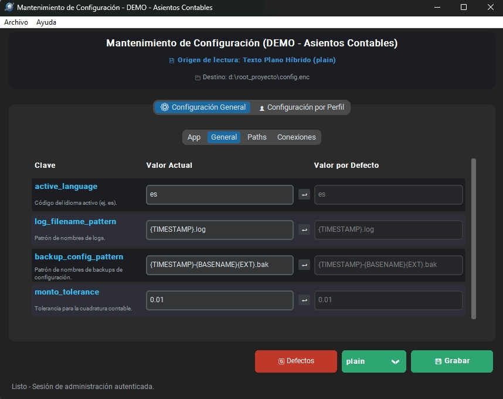
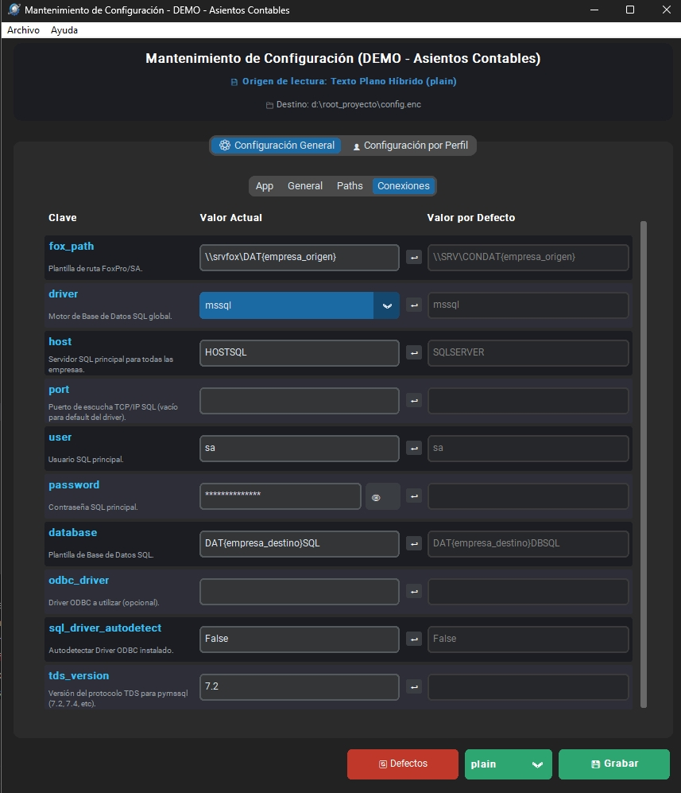
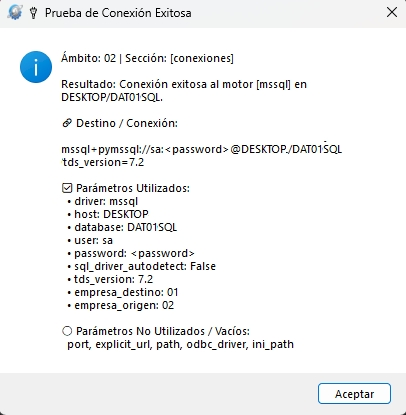
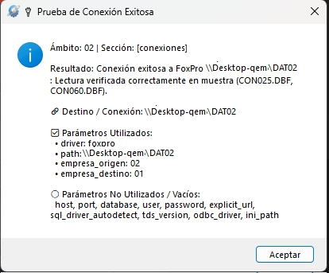
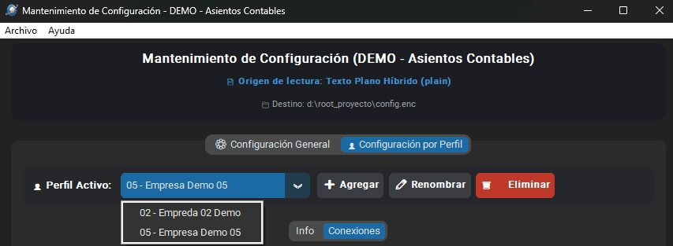
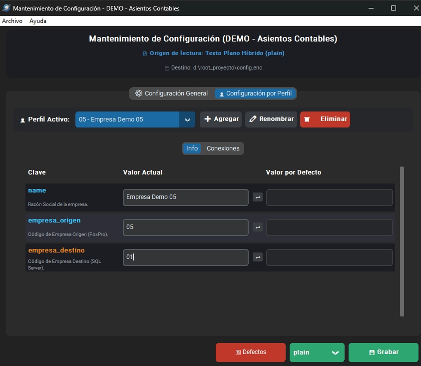
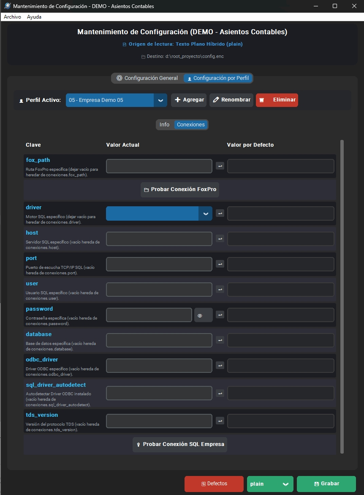
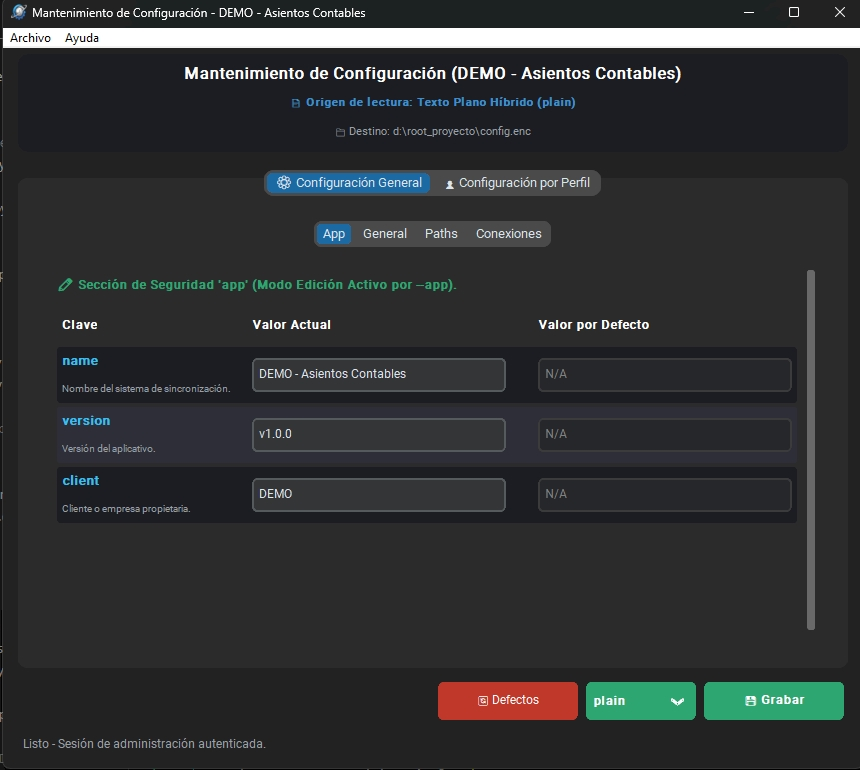

# ⚙️ pkg-asiscfg

[🇪🇸 Español](README.md) | [🇺🇸 English](README.en.md)

[](LICENSE) [](https://www.python.org/) [](#-architecture-and-design-principles-5-layer-fail-fast) [](#-security-and-cryptography)

This package delivers a complete, centralized, decoupled, ultra-high-performance **configuration management, strict schema validation, and cryptographic security** solution with zero runtime overhead for any Python project (desktop apps such as PyQt/CustomTkinter, CLI tools, background daemon services, or web servers).

**pkg-asiscfg** is the core infrastructure for configuration management, schema validation, and cryptographic security used across the **Asisnet** application suite.

--------------------------------------------------------------------------------

#### 📋 Table of Contents

1. [🎯 Why pkg-asiscfg? (Purpose and Motivation)](#-why-pkg-asiscfg-purpose-and-motivation)
2. [🚀 Key Features and Capabilities](#-key-features-and-capabilities)
3. [🖥️ Administrative Interface Visual Tour](#️-administrative-interface-visual-tour)
   - [1. General System Configuration](#1-general-system-configuration)
   - [2. Global Connection Management](#2-global-connection-management)
   - [3. Real-Time Connectivity Testing (pkg-asisdb Integration)](#3-real-time-connectivity-testing-pkg-asisdb-integration)
   - [4. Profile Selector and Management](#4-profile-selector-and-management)
   - [5. Detailed Configuration by Profile](#5-detailed-configuration-by-profile)
   - [6. Application Parameters and Administrative Security](#6-application-parameters-and-administrative-security)
4. [📦 Installation](#-installation)
   - [1. Direct Installation from GitHub (Recommended)](#1-direct-installation-from-github-recommended)
   - [2. Installation from Local Source Code](#2-installation-from-local-source-code)
   - [3. Immediate Portable Demo Execution (demo/)](#3-immediate-portable-demo-execution-demo)
5. [🏗️ Architecture and Design Principles (5-Layer Fail-Fast)](#-architecture-and-design-principles-5-layer-fail-fast)
6. [🔒 Security and Cryptography](#-security-and-cryptography)
   - [1. Supported Cryptographic Engines (FORMAT_MODES)](#1-supported-cryptographic-engines-format_modes)
   - [2. Forensic Sealing in PLAIN Mode (security_level: 1)](#2-forensic-sealing-in-plain-mode-security_level-1)
   - [3. Canonical Password Invariant and Cumulative Validation](#3-canonical-password-invariant-and-cumulative-validation)
   - [4. Key Integrity and Recovery (KeyRecoveryDialog)](#4-key-integrity-and-recovery-keyrecoverydialog)
   - [5. Environment Variable Syntactic Wildcards ({ENV:...})](#5-environment-variable-syntactic-wildcards-env)
7. [📁 Recommended Consumer Project Structure](#-recommended-consumer-project-structure)
8. [🛠️ Quick Start Guide for Developers](#️-quick-start-guide-for-developers)
   - [1. Schema Definition (config_schema.py)](#1-schema-definition-config_schemapy)
   - [2. Anatomy and Structure of the Physical File (.cfg)](#2-anatomy-and-structure-of-the-physical-file-cfg)
   - [3. Initialization in the Client Application (Step 0)](#3-initialization-in-the-client-application-step-0)
   - [4. Profile Helper Methods](#4-profile-helper-methods)
9. [💻 Console and Administrative Operations (CLI)](#-console-and-administrative-operations-cli)
   - [Canonical CLI Parameters Table](#canonical-cli-parameters-table)
10. [👥 Contact and Support](#-contact-and-support)
11. [📄 License](#-license)

--------------------------------------------------------------------------------

#### 🎯 Why pkg-asiscfg? (Purpose and Motivation)

In enterprise and mission-critical application engineering, configuration handling frequently devolves into a **repetitive, tedious, and highly vulnerable chore**:
*   **Constant Code Reinvention**: Each new software project reinvents its own ad-hoc routine to read and write config files on disk.
*   **Plaintext Exposed Credentials**: Database and service passwords remain exposed in cleartext or protected by fragile, easily reversible obfuscations.
*   **Scattered Validations and Late Failures**: Type, boundary, and mandatory field checks are scattered across business logic, leading to unexpected runtime crashes in production.
*   **Costly Refactoring for Multi-Tenancy**: Introducing multi-branch, multi-company, or multi-environment support forces comprehensive restructuring across entire codebases.
*   **Manual Tampering and Silent Corruption**: Manual editing by operators or technicians frequently corrupts critical keys without audit trails or forensic detection.

**`pkg-asiscfg` was engineered from the ground up to eliminate these problems once and for all**, delivering a **turnkey, modular, resilient, and ultra-high-performance** solution:
1.  **Step 0 in a Single Line (`init_app_config`)**: Autonomously resolves physical paths, validates schemas, decrypts keys, and yields an immutable, structured config object ready for immediate consumption.
2.  **100% Deterministic Security**: Zero plaintext credentials, canonical invariant for empty passwords, early tamper detection (*Fail-Fast*), and industrial cryptographic engines (AES-256-GCM, ChaCha20, Fernet).
3.  **Maximum Constant-Time Performance ($O(1)$)**: Lightweight memory footprint powered by `__slots__` models, zero CPU overhead, and no runtime clutter.
4.  **Decoupled Visual Administration (*Cold Path*)**: Modern desktop graphical interface for technicians and administrators that never penalizes memory consumption or cold startup times of host applications.

--------------------------------------------------------------------------------

#### 🚀 Key Features and Capabilities

*   **Unified "Step 0" Initialization (`init_app_config`)**: Initializes host application configuration in a single strictly-typed call returning an immutable structured object (`ConfigBootstrap`).
*   **Radical UI Isolation (*Cold Path*)**: The graphical user interface (`customtkinter`) lives on a cold execution path; in consumption mode (`consume`), UI modules are never imported into `sys.modules`, guaranteeing zero RAM overhead and instant boot times.
*   **Direct Constant-Time Queries ($O(1)$)**: High-frequency lookup methods (`valor`, `valorpass`, `valor_profile`, `valorpass_profile`, `valor_parent`, `valorpass_parent`) optimized with `__slots__` and direct memory resolution.
*   **JIT Decryption and Zero Plaintext Passwords**: Passwords are decrypted Just-In-Time (*JIT*) in memory strictly upon calling `valorpass*()`.
*   **Canonical Invariant `NULL_SENTINEL`**: Empty passwords are encrypted and persisted under the canonical sentinel token `<%null$>` and delivered to consumers as an empty string `""`. A password is never stored or assumed in plaintext.
*   **Cumulative Error Validation (Single-Pass)**: Rather than aborting at the first broken field, the loading pipeline analyzes the entire file, identifying password failures, missing environment variables, or absent profile headers, consolidating all findings into a unified audit trail and error report.
*   **Environment Variable Syntactic Wildcards (`{ENV:...}`)**: Native support for interpolating environment variables in any schema field or physical file via `{ENV:VAR_NAME}` or `{ENV:VAR_NAME:default_val}`, featuring fail-fast verification in production and visual preservation in the UI.
*   **Surgical Atomic Persistence (`save_values`)**: Selectively updates and persists specific keys to disk without full-file overwrite hazards, synchronizing in-memory state in $O(1)$ while keeping automated backups and forensic seals up to date.
*   **Declarative CLI Parameters (`app_help`)**: Empowers host applications to declare CLI arguments with automatic type casting (`int`, `float`, `bool`, `str`), mandatory flags (`required`), and option restrictions (`choices`), with symmetric support for `/`, `-`, and `--` prefixes.
*   **Zero Argument Leakage**: Host application positional arguments (e.g., CLI parameters without flag prefixes) remain completely untouched and isolated in `boot.remaining_args`.
*   **Forensic Sealing in PLAIN Mode (`security_level: 1`)**: Retains human-readable JSON files while signing an encrypted snapshot under `_NO_MODIFICAR_NO_MODIFY`. Unauthorized out-of-band disk alterations trigger audit logs (`[AUDIT-TAMPER]`) and display the interactive `DiffWarningDialog` in the UI.
*   **Interactive Key Recovery (`KeyRecoveryDialog`)**: If the cryptographic `.key` file is lost or corrupted, the system halts production immediately or guides administrators through safe backup restoration or controlled key regeneration.
*   **Public Informative Metadata (`# public`)**: Fields marked as public are serialized at the physical file header as comments (`# <key>: <value>`), readable in standard text editors (e.g., Notepad) even when payloads are fully encrypted.
*   **Integrated i18n Localization**: Direct support for localized schema descriptions via the `t18n#` prefix in seamless integration with `pkg-i18n`.
*   **Automated Headless Deployment (`--install`)**: Unattended deployment flag that initializes cryptographic keys and default configuration files on fresh installations.

--------------------------------------------------------------------------------

#### 🖥️ Administrative Interface Visual Tour

The `pkg-asiscfg` administrative tool provides a modern, intuitive visual environment to safely manage system configurations:

##### 1. General System Configuration
Global company metadata, working directories, and core operational preferences.


--------------------------------------------------------------------------------

##### 2. Global Connection Management
Centralized management of database engines, ports, network instances, and credentials with live connectivity testing.


--------------------------------------------------------------------------------

##### 3. Real-Time Connectivity Testing (`pkg-asisdb` Integration)
Instant credential and endpoint verification across relational database engines (SQL Server, PostgreSQL, MySQL, Oracle, SQLite) and local/network tabular data stores (Visual FoxPro / DBF).

| SQL Server Verification | FoxPro / DBF Verification |
| :---: | :---: |
|  |  |

###### How Does the Connection Test Work?
When clicking the test button in the graphical interface:
1.  **Live State Gathering**: The UI synchronizes active screen inputs without requiring an intermediate save to disk.
2.  **Secure Just-In-Time Decryption**: Protected passwords (`is_password: True`) are decrypted transiently in memory for the probe without exposing plaintext secrets.
3.  **Dynamic Wildcard Resolution**: Placeholders (such as `[target_company]` or `{ROOT}`) inside database names or paths are evaluated in real time.
4.  **Delegation to `pkg-asisdb`**: Invocates `asisdb.engine.test_connection(driver=driver, **other_params)`, verifying network reachability, authentication, and table access.
5.  **Diagnostic Feedback**: Displays a modal window detailing the verdict (success or root cause of failure), active connection parameters, omitted keys, and generated connection strings (masking passwords).

###### How is it Declared in the Schema (`config_schema.py`)?
Test triggers are declared as fields with `"type": "test_connection"` and a `"mapping"` directive linking driver parameters with interface fields:

```python
# Profile-level test button with cascaded inheritance (Profile -> Global)
"btn_test_db": {
    "type": "test_connection",
    "description": "t18n#🔌 Test Profile Connection",
    "mapping": {
        "driver": ["driver", "database.driver"],       # Cascade: Profile -> Global (sqlite)
        "database": ["database", "database.database"], # Cascade: demo_01.db -> demo_{profile}.db
        "user": ["user", "database.user"],             # Cascade: Profile -> Global (admin_general)
        "password": ["password", "database.password"]  # Cascade: Profile -> Global (JIT decrypted)
    }
},

# Global-level test button with fixed literal values
"btn_test_db_global": {
    "type": "test_connection",
    "description": "t18n#🔌 Test Global Connection",
    "mapping": {
        "driver": "database.driver",
        "database": LITERAL("demo_global.db"),         # Fixed immutable literal
        "user": "database.user",
        "password": "database.password"
    }
}
```

**Parameter Resolution Rules inside `mapping`**:
*   **Cascaded Resolution (List)**: `["driver", "database.driver"]` or `["password", "database.password"]`. The button evaluates targets in order: checks the active profile first; if blank, falls back to the parent global section.
*   **Fixed Literals**: `LITERAL("demo_global.db")` or `"literal:sqlite"`. Binds a fixed value without requiring editable input fields in the UI.
*   **Dynamic Wildcards**: Allows templating such as `demo_{profile}.db` or `DATA_[target_company]_SQL` resolved dynamically per profile.
*   **Supported Drivers**: `sqlite`, `mssql` (SQL Server), `postgres` (PostgreSQL), `mysql` (MySQL / MariaDB), `oracle`, and `foxpro` (Visual FoxPro / DBF tables).

--------------------------------------------------------------------------------

##### 4. Profile Selector and Management
Native multi-profile support (subsidiaries, company branches, execution stages, or isolated workspaces), featuring automated synchronization and alphabetical ordering.


--------------------------------------------------------------------------------

##### 5. Detailed Configuration by Profile
Each profile isolates its corporate identity and distinct connection endpoints:

| Profile Identification & Data | Per-Profile Database Connections |
| :---: | :---: |
|  |  |

--------------------------------------------------------------------------------

##### 6. Application Parameters and Administrative Security
Protected zone guarded by UAC elevation and administrative access control to configure software identity and internal runtime parameters.


--------------------------------------------------------------------------------

#### 📦 Installation

##### 1. Direct Installation from GitHub (Recommended)
Install directly into your virtual environment via `pip`:
```powershell
pip install git+https://github.com/borispinto/pkg-asiscfg.git
```

Or declare it in your `requirements.txt`:
```text
pkg-asiscfg @ git+https://github.com/borispinto/pkg-asiscfg.git
```

Or in your `pyproject.toml`:
```toml
[project]
dependencies = [
    "pkg-asiscfg>=1.0.0",
]
```

--------------------------------------------------------------------------------

##### 2. Installation from Local Source Code
Standard repository cloning and installation:
```powershell
git clone https://github.com/borispinto/pkg-asiscfg.git
cd pkg-asiscfg
pip install .
```

Or in editable mode for local development:
```powershell
pip install -e .
```

--------------------------------------------------------------------------------

##### 3. Immediate Portable Demo Execution (`demo/`)
The repository includes a self-contained, pre-configured demo with SQLite and multi-profile setups (`01` and `02`) in the `demo/` folder, ready to run without external database servers:

```powershell
# 1. Clone the repository and enter workspace
git clone https://github.com/borispinto/pkg-asiscfg.git
cd pkg-asiscfg

# 2. Install package in editable mode
pip install -e .

# 3. Launch interactive administrative UI in developer mode
python demo/demo.py --ui --dev
```

>[!TIP]
>**Console Mode**: To inspect in your terminal how configuration initializes, how global values are queried, and how cascaded inheritance functions (`valor_parent` and `valorpass_parent`), run:
>```powershell
>python demo/demo.py
>```

>[!NOTE]
>**Environment and Ecosystem Requirements**:
>*   **Consumption Mode (Services / Production)**: Only requires `cryptography>=40.0.0` (bundled in standard package requirements). Graphical UI modules are never imported into memory.
>*   **Visual Administrative Mode (`--ui`)**: Requires desktop GUI support (`customtkinter` and `Pillow`).
>*   **Comprehensive Suite Integration**:
>    *   **`pkg-asisdb`**: Infrastructure library required to run active database connectivity tests (`test_connection`) in the UI.
>    *   **`pkg-i18n`**: Library required for dynamic localization of schema descriptions prefixed with `t18n#`.

--------------------------------------------------------------------------------

#### 🏗️ Architecture and Design Principles (5-Layer Fail-Fast)

The package operates under a strict 5-tier sequential hierarchy where each layer guarantees 100% of its contract, eliminating redundant defensive checks across boundaries:

| Layer | Component | Responsibility and Fail-Fast Principle |
| :---: | :--- | :--- |
| **1** | **CLI & Parsing** (`asiscfg.cli`) | Deterministic syntax validation, strict type casting, and complete isolation of host positional arguments (`remaining_args`). |
| **2** | **Context & Cryptography** (`asiscfg.context`, `asiscfg.crypto`) | Absolute path resolution, physical key verification in RAM, and $O(1)$ cryptographic engine selection. |
| **3** | **Persistence & Schema** (`asiscfg.schema`, `asiscfg.storage`) | Structural validation against `CONFIG_SCHEMA`, public metadata serialization (`# public`), forensic sealing, and cumulative failure detection. |
| **4** | **In-Memory Structure** (`asiscfg.models`) | `ConfigDict` and `ConfigBootstrap` models optimized with `__slots__ = True` for minimal RAM footprint and zero execution overhead. |
| **5** | **Data Delivery** (`ConfigDict.valor*`) | Constant-time queries ($O(1)$) and Just-In-Time (*JIT*) password decryption executed strictly on `valorpass*` calls. |

##### Guiding Architectural Principles
1.  **Deterministic Security**: Zero tolerance for silent fallbacks. If a protected field is modified or corrupted, the system halts production immediately (*Fail-Fast*).
2.  **Architectural Duality (*Cold Path*)**: The visual administrative GUI (`asiscfg.ui`) loads on demand; in `consume` mode, GUI libraries (`tkinter`, `customtkinter`) never enter `sys.modules`.
3.  **Inviolability of Production Efficiency**: Production code never adopts sluggish fallbacks or redundant defensive shims to simplify unit testing; tests adapt to production contracts.

--------------------------------------------------------------------------------

#### 🔒 Security and Cryptography

Security in `pkg-asiscfg` is **100% deterministic** and enforces strict *Fail-Fast* rules: upon any tampering, mismatch, or invalid credential, the system interrupts execution in production to protect business data integrity.

##### 1. Supported Cryptographic Engines (`FORMAT_MODES`)

| Engine | Identifier | Cryptographic Characteristics | Recommended Use Case |
| :--- | :--- | :--- | :--- |
| **Plain** | `plain` | Human-readable JSON with field-by-field Fernet encryption for secrets. Supports forensic snapshot sealing. | Development, debugging, and direct auditing. |
| **Fernet** | `fernet` | Symmetric authenticated encryption (AES-128-CBC + HMAC-SHA256). | Standard cross-platform production. |
| **AES-256-GCM** | `aes256_gcm` | Military-grade 256-bit authenticated cipher accelerated by hardware (AES-NI). | High-volume and mission-critical production. |
| **ChaCha20** | `chacha20` | 256-bit Poly1305 authenticated stream cipher. Ultra efficient on CPUs without AES-NI. | Virtualized, containerized, embedded, or mobile devices. |

##### 2. Forensic Sealing in PLAIN Mode (`security_level: 1`)
In `plain` format, declaring `_security_level: 1` seals an encrypted forensic snapshot under `@NO_MODIFICAR_NO_MODIFY`. If a technician or operator manually edits keys on disk:
*   In **production**, the discrepancy is recorded in the audit log (`[AUDIT-TAMPER]`).
*   In the **administrative UI (`--ui`)**, the `DiffWarningDialog` appears, presenting the exact keys changed, original sealed values, and current values on disk.

##### 3. Canonical Password Invariant and Cumulative Validation
*   **Canonical Invariant `NULL_SENTINEL`**: Empty passwords are **never stored in plaintext** nor assumed by default. They are persisted encrypted under the sentinel token `NULL_SENTINEL` (`"<%null$>"`). When decrypted via `valorpass*()`, they return as empty strings `""`.
*   **Single-Pass Cumulative Validation**: Unlike legacy systems that abort upon encountering the first broken key, `load_config` inspects the entire file (globals and all `@profiles`), identifying and accumulating all anomalies:
    1.  **Missing Field (`missing`)**: The key required by the schema does not exist physically on disk.
    2.  **Unencrypted Secret (`unencrypted_passwords`)**: A protected field stored in plaintext without the `ENC:` prefix.
    3.  **Empty Token (`empty`)**: Field includes the `ENC:` prefix but lacks an encrypted body.
    4.  **Decryption Failure (`decrypt_error`)**: Cryptographic error due to mismatched keys or altered tokens.
    5.  **Missing Environment Variable (`env_missing`)**: `{ENV:...}` placeholder not defined in the OS and lacking defaults.
    6.  **Missing Required Profiles (`profiles_missing`)**: Schema expects `@profiles` but none exist on disk.
*   **Behavior by Execution Mode**:
    *   **In Production (`edit_mode=False`)**: Logs each error (`logging.error`), creates forensic audit events (`log_audit_event`), and halts immediately by raising a single consolidated `ValueError` detailing all compromised paths.
    *   **In UI / Edit Mode (`edit_mode=True`)**: Logs warnings and allows administrators to correct values interactively on screen.

##### 4. Key Integrity and Recovery (`KeyRecoveryDialog`)
On startup, physical existence and mathematical compatibility of the `.key` file are strictly verified. If the key file is lost or mismatched:
*   In **production**, startup terminates immediately.
*   In **elevated administrative mode (`--dev` or Administrator)**, the interactive recovery wizard enables:
    1.  Locating and restoring a valid `.key` backup copy.
    2.  Regenerating a fresh key with safe reinitialization to schema defaults.

##### 5. Environment Variable Syntactic Wildcards (`{ENV:...}`)
`pkg-asiscfg` decouples credentials, hosts, ports, and dynamic paths using environment wildcards in strings, lists, or dictionaries:
*   **Declarative Syntax**:
    *   `{ENV:VAR_NAME}`: Strictly requires the variable to exist in the host operating system.
    *   `{ENV:VAR_NAME:default_value}`: Uses the fallback value if the environment variable is not defined.
*   **Deterministic Fail-Fast Resolution**:
    *   In **consumption / production mode (`consume`)**, values interpolate at Layer 3. If a required variable is missing and lacks a default, startup halts immediately (*Fail-Fast*) reporting `env_missing`.
    *   In **graphical UI mode (`--ui`)**, the raw token is preserved as text (e.g., `{ENV:DB_HOST:localhost}`), allowing administrators to inspect and edit templates without overwriting references with local environment values.

--------------------------------------------------------------------------------

#### 📁 Recommended Consumer Project Structure

```text
my_project/
├── pyproject.toml / requirements.txt  # Declares dependency on pkg-asiscfg
├── demo.cfg                           # Physical config file (encrypted or plain)
├── demo.key                           # Physical cryptographic key (production)
└── demo/
    ├── core/
    │   └── config_schema.py           # Canonical schema definition and validation rules
    └── demo.py                        # Step 0 Bootstrap: init_app_config(...)
```

>[!NOTE]
>`pkg-asiscfg` resolves physical paths deterministically: searches the current working directory first or adjacent to the executable (`sys.executable` when compiled via PyInstaller). `.cfg` and `.key` files always reside on the host file system.

--------------------------------------------------------------------------------

#### 🛠️ Quick Start Guide for Developers

##### 1. Schema Definition (`config_schema.py`)
Create a `config_schema.py` file in your project declaring structure, data types, validation rules, and profile templates:

```python
  1 # demo/core/config_schema.py
  2 from asiscfg import LITERAL
  3 
  4 CONFIG_SCHEMA = {
  5     # ── Configuration Policies ──
  6     "_security_level": 1,
  7     "_backup": {
  8         "enabled": True,
  9         "method": "timestamp",
 10         "target_dir": "{ROOT}/backups",
 11         "filename_pattern": "{TIMESTAMP}-{BASENAME}{EXT}.bak",
 12         "max_backups": 20
 13     },
 14 
 15     # ── 1. Application and Security Section ──
 16     "app": {
 17         "nombre": {
 18             "type": "str",
 19             "default": "Enterprise Connector Demo",
 20             "description": "Application Name",
 21             "public": True
 22         },
 23         "version": {
 24             "type": "str",
 25             "default": "1.0.0",
 26             "description": "Software Version",
 27             "public": True
 28         },
 29         "debug": {
 30             "type": "bool",
 31             "default": False,
 32             "description": "Enable Debug Mode"
 33         }
 34     },
 35 
 36     # ── 2. General Business Section ──
 37     "general": {
 38         "idioma": {
 39             "type": "str",
 40             "default": "en",
 41             "description": "Active Language Code",
 42             "public": True
 43         },
 44         "empresa": {
 45             "type": "str",
 46             "default": "Acme Corp Ltd.",
 47             "description": "Company Legal Name",
 48             "public": True
 49         }
 50     },
 51 
 52     # ── 3. Global Section (Parent): Shared Database ──
 53     "database": {
 54         "driver": {
 55             "type": "str",
 56             "default": "sqlite",
 57             "description": "Global Database Engine",
 58             "public": True
 59         },
 60         "database": {
 61             "type": "str",
 62             "default": "demo_{profile}.db",
 63             "description": "Global DB File Path / Template"
 64         },
 65         "user": {
 66             "type": "str",
 67             "default": "admin_general",
 68             "description": "Default Global User"
 69         },
 70         "password": {
 71             "type": "str",
 72             "default": "GlobalSecretPassword123",
 73             "is_password": True,
 74             "description": "Default Global Password"
 75         },
 76         "btn_test_db_global": {
 77             "type": "test_connection",
 78             "description": "🔌 Test Global Connection",
 79             "mapping": {
 80                 "driver": "database.driver",
 81                 "database": LITERAL("demo_global.db"),
 82                 "user": "database.user",
 83                 "password": "database.password"
 84             }
 85         }
 86     },
 87 
 88     # ── 4. Multi-Profile Section (@profiles): Branches & Inheritance ──
 89     "@profiles": {
 90         "_template": {
 91             "info": {
 92                 "nombre": {
 93                     "type": "str",
 94                     "default": "",
 95                     "description": "Branch Name",
 96                     "public": True
 97                 },
 98                 "codigo": {
 99                     "type": "str",
100                     "default": "01",
101                     "description": "Branch Code"
102                 }
103             },
104             "database": {
105                 "driver": {
106                     "type": "str",
107                     "default": "",
108                     "description": "Engine (blank = inherits from global parent)"
109                 },
110                 "database": {
111                     "type": "str",
112                     "default": "",
113                     "description": "Profile DB Name (blank = inherits)"
114                 },
115                 "user": {
116                     "type": "str",
117                     "default": "",
118                     "description": "User (blank = inherits from global parent)"
119                 },
120                 "password": {
121                     "type": "str",
122                     "default": "",
123                     "is_password": True,
124                     "description": "Password (blank = inherits from global parent)"
125                 },
126                 "btn_test_db": {
127                     "type": "test_connection",
128                     "description": "🔌 Test Profile Connection",
129                     "mapping": {
130                         "driver": ["driver", "database.driver"],
131                         "database": ["database", "database.database"],
132                         "user": ["user", "database.user"],
133                         "password": ["password", "database.password"]
134                     }
135                 }
136             }
137         },
138         # Profile 01: Main Branch (HQ)
139         "01": {
140             "info": {
141                 "nombre": "Headquarters Branch",
142                 "codigo": "01"
143             },
144             "database": {
145                 "database": "demo_01.db"
146             }
147         },
148         # Profile 02: Secondary Branch with custom user
149         "02": {
150             "info": {
151                 "nombre": "Secondary Branch",
152                 "codigo": "02"
153             },
154             "database": {
155                 "user": "branch_supervisor_02"
156             }
157         }
158     }
159 }
```

##### Schema Line-by-Line Breakdown and Declaration Rules:

The schema contract governs validation, GUI rendering, and physical persistence:

| Element / Directive | Role in Schema | Purpose and Declaration Rules |
| :--- | :--- | :--- |
| **`LITERAL`**<br>*(Line 2)* | Import Helper | Canonical helper imported from `asiscfg` to bind static literals inside `mapping` blocks (such as `LITERAL("demo_global.db")` in line 81) without linking them to editable inputs in the GUI. |
| **`CONFIG_SCHEMA`**<br>*(Line 4)* | Root Dictionary | Root contract declaring global policies, scalar sections, security zones, and multi-profile modules. |
| **`_security_level`**<br>*(Line 6)* | Tamper-Sealing Policy | File integrity level. When set to `1` in `PLAIN` mode, calculates and stores an encrypted snapshot under `@NO_MODIFICAR_NO_MODIFY`. External tampering triggers `[AUDIT-TAMPER]` logs and `DiffWarningDialog`. |
| **`_backup`**<br>*(Lines 7 to 13)* | Automatic Backup Policy | Backup strategy applied before writing to disk: status (`enabled: True`), rotation mode (`method: "timestamp"`), wildcard destination (`target_dir: "{ROOT}/backups"`), naming pattern, and retention limits (`max_backups: 20`). |
| **Wildcards `{ENV:...}`**<br>*(Any scalar value)* | Syntactic Expression | Parametrizes configuration keys using operating system environment variables (`{ENV:VAR}` or `{ENV:VAR:default}`). Evaluated fail-fast at boot in production, and preserved as editable templates in the UI. |
| **`"app"`**<br>*(Lines 16 to 34)* | Canonical Security Section | Houses application metadata (`nombre`, `version`, `debug`). Stored encrypted with Fernet (`ENC:`) and displayed as read-only in the UI (unless launched with `--edit`). |
| **`public: True`**<br>*(Lines 21, 27, 42, 49, 58, 96)* | Public Visibility Attribute | Emits key-value pairs as comments (`# public`) at the top of the `.cfg` file. Allows monitoring tools and sysadmins to inspect status in text editors without decrypting data. Mutually exclusive with `is_password`. |
| **`"general"`**<br>*(Lines 37 to 50)* | Custom Domain Section | Arbitrary business section (`idioma`, `empresa`). Schema sections are open and flexible; their keys participate in inheritance if queried via `valor_parent*`. |
| **`"database"`**<br>*(Lines 53 to 86)* | Custom Domain Section | Shared database connection details (`driver`, `database`, `user`, `password`). Acts as fallback parent for profile-level cascaded queries. |
| **`is_password: True`**<br>*(Lines 73 and 123)* | Cryptographic Secret Flag | Marks sensitive fields encrypted with Fernet under the `ENC:` prefix. Masked in UI (`••••••`). Stored as `NULL_SENTINEL` if left blank. |
| **`btn_test_db_global`**<br>*(Lines 76 to 85)* | Global Test Button | Field of `"type": "test_connection"`. Generates a test button in the UI. The `mapping` binds connection keys to schema paths and fixed literals. |
| **`"@profiles"`**<br>*(Lines 89 to 158)* | Canonical Multi-Profile Block | Manages isolated workspaces or branches. Declares the required `_template` and default seed profiles (`"01"` and `"02"`). |
| **`"_template"`**<br>*(Lines 90 to 136)* | Mandatory Profile Template | Defines profile schema structure. If a field defaults to `""`, it cascades to parent global keys when accessed via `valor_parent()` or `valorpass_parent()`. Can also redirect fallbacks to arbitrary global sections via `key_path_parent`. |
| **`btn_test_db` in Profile**<br>*(Lines 126 to 135)* | Profile-Aware Test Button | Test button using cascading fallback lists (`["driver", "database.driver"]`), evaluating profile values first before falling back to global roots. |
| **Concrete Profiles `"01"` & `"02"`**<br>*(Lines 138 to 157)* | Profile Seeds (100% Optional) | **100% Optional**: Declared in schema strictly to seed default profiles on initial creation. If omitted, files can initialize without profiles and have them added dynamically via UI or API. |

--------------------------------------------------------------------------------

##### 2. Anatomy and Structure of the Physical File (`.cfg`)

Real-world configuration file generated by `pkg-asiscfg` ([`demo/demo.cfg`](demo/demo.cfg)) in `PLAIN` format with forensic sealing:

```ini
 1 # ASISCFG_PLAIN
 2 # app.nombre: Demo Conector Empresarial
 3 # app.version: 1.0.0
 4 # general.idioma: es
 5 # general.empresa: Corporación Demo C.A.
 6 # database.driver: sqlite
 7 # @profiles.01.info.nombre: Sucursal Principal
 8 # @profiles.02.info.nombre: Sucursal Secundaria
 9 {
10     "app": {
11         "nombre": "ENC:gAAAAABq1rBTc9T3yzBo90eBWuFHfUc844-HqcPZkl6ngjR-iLEuVBYUfrv-zlO8_VG-3W7HPJJCMSeZxw2RjlLyqce-U0oB-L2RAytNAqIabtdkvYLwU9U=",
12         "version": "ENC:gAAAAABq1rBTYqjn5V3AwhpkboWBlrJWt9UHRL61sYvQ1Qif1z9vZu1UcE9VSYDsPKyAMEdA780aXS1xXHa0FRklYuSMuQ0Vkg==",
13         "debug": "ENC:gAAAAABq1rBT5JOyHV9-MaZL9aT-nv6SEV7M-TUudkleQ0Yg_OLpvwd2EN2RAr3DqxN-Yo9WLYPkOFJ45JoZ3ADXedSiz1_s5g=="
14     },
15     "general": {
16         "idioma": "es",
17         "empresa": "Corporación Demo C.A."
18     },
19     "database": {
20         "driver": "sqlite",
21         "database": "demo_{profile}.db",
22         "user": "admin_general",
23         "password": "ENC:gAAAAABq1rAX2IrvJuYS0mSPX3eiLj2a9IuTq8UpZUNOVwelCY_vPXbk9P3YUREkbdiooeSPh8EBsM1gGFKKpegP9IFB24BXLA=="
24     },
25     "@profiles": {
26         "01": {
27             "info": {
28                 "nombre": "Sucursal Principal",
29                 "codigo": "01"
30             },
31             "database": {
32                 "driver": "",
33                 "database": "demo_01.db",
34                 "user": "",
35                 "password": "ENC:gAAAAABq1rBTifBoK1JtpMYhPcWWI5_i08ek_6uZtj9lfFn5eueRxJLmpkDiClEv86r5KdEDNeb3yo6IwtzJjQTruJQjVuThCw=="
36             }
37         },
38         "02": {
39             "info": {
40                 "nombre": "Sucursal Secundaria",
41                 "codigo": "02"
42             },
43             "database": {
44                 "driver": "",
45                 "database": "",
46                 "user": "supervisor_sucursal_02",
47                 "password": "ENC:gAAAAABq1rBTMDEwsiBIl9EoyoVrxq-kpZfKfKtuxVtumu4ViRePJiMHsSDcDuzAEHdI4crflEuPvMGxbO6xG8-HisNjlXA5DQ=="
48             }
49         }
50     },
51     "@asiscfg": {
52         "admin_pass_hash": "2a97516c354b68848cdbd8f54a226a0a55b21ed138e207ad6c5cbb9c00aa5aea"
53     },
54     "@NO_MODIFICAR_NO_MODIFY": "gAAAAABq1rBTnfJ2w7oEx5QlYD9ba3tgOP6Beuzxv0W6SlxY0MIpPxi2wi97JrhsvuMyoAWY1K6DmkoCtWJJ6P75RwkBSd1nGogiB4d3jd3c-zFgXVCgbhDrC_mwaGweiRVlmxoQ1Z6U74ZdRPn0kwFH9QWnC3uZU8EUqebOzW98tnPZVG_x_eBK2xnxQ_mpbtsNaaPBjTqzUWH0TwiZ5Piv8kWF1aogqEstrSw0HpaxS3NoA5aDMbUp4FTzzsIFGkcCdQjVzAYHKb9PAeFzqcCBUl9xkw5CoFD1w4qhwUo-KzR01pcpV_Jbur75rvvxBDazot1u6Lj1LbOlAAqRbqCOGfSYsyFHWhLM0i-KTqbC_7Mq-ggsG3-g_RO31Js1Tx8KXdzIZ2hjhggZqxtbsTHZLgCiPypCo4z0_aMV8N55d0QiV_OS7NvmKcDOxuLi3AfSBM_CqjJ7Q0V52jIILKHxC0UXfLF6CSDSiXcBHutEqhVdnNUZbXdka9n5J-bp-6DlLtBoN_OC6DuSfgSXxXAOfEvwS_HRPdhO7S2ErNs1dD1txSk-25Xp1IXGgcEsm0uymY0VIkDT4oq1FSwshJH1e81NvyKu50kqlCfesaD-J5Cmq1auK3eAfaN3v9lIfrHLXCzo28rU55t91OkSNbCjZEvh3bJ1lLgXf88fAcbjYfGu-0DOKFGnbRW4aMsBg8ecAzFqL61xVRPkWgWhC3g8ly7QacWx3ZSJiNdz7hOAawXzdHf8s5k2_2LDlK6ygb66qc-wCQ0dRkGQqaUiGhXEODnUCrwq2R01gSPmNI0Y-OoMbDm-dRvdxr12XgKio8X7hqeDaddHgxZTNE1rN2xT92cT5thFXesIlOAASvjDsTyjIYzY-UR7bq2pQDCj3_ajMdGefUEJWueuh-_5FGiToOE1QAl7Q6EtzcaV6Zm11bhi8GJgbZ3mkYm6umU_jGDo58oWm7XsL-uYz65FZ9WN19dThL8jnoILImcqU6BNIieTCmaTNR-Wit2NO3WIiULTRGsmSkwswSU6r0IggLJE_q_P0lvcXQapL7MWFhaYUcWqyJG5E2K0JwE4ifNgOGvlXeXXgiSqW1o0aHys94w-bP2h6g3P3rCi_nTQLsi_joKIGD_3Yq5zvXLxJ5nvweKkj2-88gqzZP2vmLQzNnCQyKKGPtd5YLioZug2_seacGnyc2IsVWM5FNoBfDdXmyb-FTwMpKulebxZK7dZP_cECBWOOsRPiX9obQ6ecpyQrz-QpjA0j7lZMfhnqhwK5sRyYLLbgNPqcsvPxo25lOKFjbq5tvSyxKixy-DmYhfdmynjVgBV4YDxwVKJmQirccaTb7DHbG1MgiHWlFFs-CkisaV-OufESAmNg6fT0AyT2XhI-1-pcPqcGTqjJWPOf3-7kkSjp1UushwE8_uEXd3E6bu6D9-3Pox1olIANfSxNHLAZ8s4quosJVi-Hy5bvntuiLmfy7YE9hoh7cE71u1i-mSrxpi8-C5dKp8EPGmvywsg4pCFbMJJhQOEAZCeSQysMLCdtHH8_N_TYovnoFiU2vGYy6-yclr3hqDVK6ODxLJR3iZ0keOmWc8riCuQMmEW_FsjIOuHa0qMywKp-BkArDhV6bbQMFMXhYqfmJ7C4eM-1-rJFIynKBN4KVNJ9VZqYkcE4SU5BOZvCuLIWISw7y2gTmrZgKRQOyJkrJaeJpN_5tttvbJhNDGlRMeKAVcMVrluKi_-IWSbcyUVyuBTwZzhvf8YYEOZk9aYx6POgThWHLarVlh8WBZ5Tl0TMETTwjVzqM_m"
55 }
```

##### Canonical Sections Breakdown and Field Manipulation Rules:

| Section / Element | Type & Format | Handling Rules and Editing Behavior in Plain Text |
| :--- | :--- | :--- |
| **`# ASISCFG_PLAIN`**<br>*(Line 1)* | Format Header | **Immutable**: Identifies in $O(1)$ the cryptographic engine (`plain`, `fernet`, `aes256_gcm`, `chacha20`). Modifying it breaks engine resolution. |
| **`# public`**<br>*(Lines 2 to 8)* | Informative Comments | **Read-Only / Informational**: Automatically exported from schema fields with `"public": True`. Allows monitoring utilities and admins to inspect operational parameters without decrypting payloads. Passwords are never published. |
| **`"app"`**<br>*(Lines 10 to 14)* | Canonical Security Block | **Protected / Encrypted with `ENC:`**: Holds identity metadata (`nombre`, `version`, `debug`). Stored encrypted to avoid unauthorized tampering on disk. Read-only in GUI unless opened with `--edit`. Modifying tokens manually corrupts deterministic decryption. |
| **Plaintext Business Fields**<br>*(Lines 15-22, 27-30, 39-42)* | Native types (`str`, `int`, etc.) | **Directly Editable**: Standard parameters (`idioma`, `empresa`, `driver`, `database`, `user`). Legible and editable in text editors. If `_security_level: 1`, external modifications trigger `[AUDIT-TAMPER]` logs and display `DiffWarningDialog` in the UI. |
| **Password Fields** (`is_password: True`)<br>*(Lines 23, 35, 47)* | Fernet token with `ENC:` prefix | **Strictly Immutable in Plaintext**: Secrets **must never be written in plaintext**. Plaintext entries abort startup immediately (*Fail-Fast*) with `ValueError`. Empty passwords store as `NULL_SENTINEL`. Updates must occur via UI or API. |
| **`"@profiles"`**<br>*(Lines 25 to 50)* | Multi-Profile Module | **Profile Container**: Organizes distinct environments, branches, or tenants (`"01"` and `"02"`). Each profile holds its isolated local sections (`info`, `database`, etc.). |
| **Profile Fields & Inheritance**<br>*(Lines 31-36, 43-48)* | On-Demand (`valor_parent*`) | **Editable / Not Auto-Inherited**: Empty values (`""`) **do not auto-inherit**. Standard queries (`valor_profile`) return `""`. Cascaded fallback (`Profile -> Global -> Default`) triggers strictly via `valor_parent()` or `valorpass_parent()`. Inherits from the same key path by default, or redirects via `key_path_parent`. Profile-specific values override global keys. |
| **`"@asiscfg"`**<br>*(Lines 51 to 53)* | Administrative Section | **Immutable**: Stores SHA-256 hash (`admin_pass_hash`) for master administrator access. Missing or altered hashes block administrative UI access. |
| **`"@NO_MODIFICAR_NO_MODIFY"`**<br>*(Line 54)* | Forensic Sealing Token | **Immutable**: Active when `_security_level: 1` in `PLAIN` mode. Stores an encrypted Fernet snapshot of disk contents. Any disparity activates tamper alerts. |

--------------------------------------------------------------------------------

##### 3. Initialization in the Client Application (Step 0)
At your application entry point, bootstrap configuration in a single call via `init_app_config`:

```python
import sys
from asiscfg import init_app_config

# Canonical Step 0 bootstrap with optional declarative CLI parameters
boot = init_app_config(
    args=sys.argv[1:],
    app_title="Enterprise Connector Demo (pkg-asiscfg)",
    app_files="demo",                   # Resolves demo.cfg and demo.key
    app_schema="core/config_schema.py", # Required schema definition
    app_help={
        "description": "Portable SQLite & Multi-Profile Enterprise Demo",
        "params": {
            "period": {"type": int, "help": "Fiscal year or processing cycle"},
            "recalculate": {"type": bool, "help": "Force ledger recalculation"}
        }
    }
)

# Exit control: handles terminal actions (--help, --ui, or CLI syntax errors)
if boot.exit_code is not None:
    sys.exit(boot.exit_code)

# 1. Query global values in O(1)
app_name = boot.valor("app.nombre")
company = boot.valor("general.empresa")
db_driver = boot.valor("database.driver")
db_pass = boot.valorpass("database.password")  # Secure JIT decryption

# 2. Query validated declarative CLI parameters
fiscal_period = boot.param("period")
recalculate_flag = boot.param("recalculate")

# 3. Query strict profile values (valor_profile: does NOT inherit from parent)
branch_01 = boot.valor_profile("info.nombre", profile_code="01")
db_01_raw = boot.valor_profile("database.database", profile_code="01")

# 4. Query with on-demand cascaded inheritance: Profile -> Global (Parent) -> Default
#    (Operates exclusively when calling valor_parent or valorpass_parent)
#
#    a) Default inheritance: searches the exact same key path in the global root:
db_driver_01 = boot.valor_parent("database.driver", profile_code="01")      # Inherits 'sqlite' from global database.driver
db_file_01 = boot.valor_parent("database.database", profile_code="01")     # Uses 'demo_01.db' defined in profile
db_user_02 = boot.valor_parent("database.user", profile_code="02")         # Overridden with 'branch_supervisor_02'
db_pass_01 = boot.valorpass_parent("database.password", profile_code="01") # Inherits and decrypts JIT

#    b) Custom inheritance: redirects fallback to ANY arbitrary global section:
#       If profile doesn't define 'server', inherits from 'general.central_server'
server_01 = boot.valor_parent(
    key_path="server",
    profile_code="01",
    key_path_parent="general.central_server",  # Custom root fallback path
    default="localhost"
)

# 5. External positional arguments preserved intact
external_args = boot.remaining_args

# 6. Surgical persistence in production (save_values)
boot.save_values({"general.empresa": "Acme Corp Ltd."})
```

>[!TIP]
>**Surgical Persistence (`save_values`) vs. Full Save (`save`):**
>In production mode (`consume`), full file saving (`boot.save()`) is intentionally blocked (*Fail-Safe*) with a `RuntimeError` to prevent destructive concurrent overwrites.
>Runtime updates should always be executed surgically using `boot.save_values({"section.key": new_value})`. This call atomically writes changes to disk, executes automatic backups, refreshes forensic seals (if `security_level: 1`), and synchronizes the in-memory state in $O(1)$. The `save()` method is reserved strictly for administrative tools and the graphical interface (`--ui`).

>[!NOTE]
>**Mechanics of Cascaded Inheritance (`valor_parent` and `valorpass_parent`):**
>1. **Profile Resolution**: Evaluates if the specified profile contains a assigned value (not `None` nor empty string `""`). If present, returns it immediately.
>2. **Global Root Fallback**: If the profile value is blank or unassigned:
>    - **By Default (`key_path_parent=""`)**: Inherits by searching the **exact same key path** in the root dictionary (`key_path`). For instance, `valor_parent("database.driver", profile_code="01")` searches `"database.driver"` in the root.
>    - **Custom Redirection (`key_path_parent="section.key"`)**: Searches **any other arbitrary section** in the root. For example, `valor_parent("driver", profile_code="01", key_path_parent="database.driver")` checks `"driver"` in the profile, falling back to `"database.driver"` globally.
>3. **Final Default**: If neither profile nor global sections provide a value, returns the `default` parameter.

--------------------------------------------------------------------------------

##### 4. Profile Helper Methods

For multi-tenant or multi-branch applications, `ConfigDict` provides convenient helper methods to inspect active profile structures:

```python
# 1. Get alphabetically sorted list of registered profile codes
profile_codes = boot.config.get_profiles()  # e.g., ["01", "02"]

# 2. Check boolean indicator of profile usage
has_profiles = boot.config.has_profiles()   # True if len(get_profiles()) > 0

# 3. Extract the complete sub-dictionary of a specific profile
profile_data = boot.config.get_profile_config("01")  # {"info": {...}, "database": {...}}
```

--------------------------------------------------------------------------------

#### 💻 Console and Administrative Operations (CLI)

The `asiscfg` CLI command (or `python -m asiscfg`) accepts `/`, `-`, or `--` separators symmetrically:

```bash
# Launch administrative GUI
python -m asiscfg --ui --config-file demo.cfg --key-file demo.key --schema-file core/config_schema.py

# Enable application metadata editing tab in the UI
python -m asiscfg --ui --edit --config-file demo.cfg

# Generate a new secure cryptographic key file
python -m asiscfg --generate-key --key-file demo.key

# Export schema file to the base directory
python -m asiscfg --export-schema --schema-file core/config_schema.py

# Automated deployment / Unattended initialization (Install Mode)
python -m asiscfg --install --config-file demo.cfg --key-file demo.key --schema-file core/config_schema.py
```

##### Canonical CLI Parameters Table

>[!NOTE]
>**Separators and Syntax Equivalencies**:
>All CLI options accept `-`, `--`, and `/` prefixes symmetrically (e.g., `--config-file`, `-config-file`, and `/config-file` are 100% equivalent).
>Parameter values can be passed with spaces (`--config-file path`), equal signs (`--config-file=path`), or colons (`--config-file:path`).

| Parameter | Type | Description |
| :--- | :--- | :--- |
| `--schema-file` | Value | Path to schema definition module (`config_schema.py`). |
| `--config-file` | Value | Path to physical configuration file (`.cfg` or `.enc`). |
| `--key-file` | Value | Path to cryptographic key file (`.key`). |
| `--ui` | Flag | Launches the administrative graphical user interface. |
| `--install` | Flag | Initializes key and configuration files if absent. |
| `--edit` | Flag | Enables editing application metadata in the UI. |
| `--dev` | Flag | Developer mode (bypasses Windows UAC administrator elevation). |
| `--generate-key` | Flag | Generates a valid cryptographic key file on disk. |
| `--overwrite-key` | Flag | Overwrites existing key files during generation. |
| `--reset-admin-pass` | Flag | Resets master administrative password to its default (`admin`). |
| `--export-schema` | Flag | Copies resolved schema file to application working directory. |
| `--format-mode` | Value | Cryptographic engine: `plain`, `fernet`, `aes256_gcm`, `chacha20`. |
| `--theme` | Value | GUI color appearance mode (`dark` or `light`). |
| `--show` | Flag | Displays modal dialogs on execution alerts or errors. |
| `--debug` | Flag | Enables verbose debug logging to standard error. |
| `--i18n-path` | Value | Path to translation catalog directory (`.po` / `.mo`) for `pkg-i18n`. |
| `--last-resource` | Flag | Forces critical initialization errors to `sys.stderr`. |

--------------------------------------------------------------------------------

#### 👥 Contact and Support

This project is authored and actively maintained by **Boris Pinto**, in collaboration with **Asisnet Computación, CA**.

##### 🛠️ Authorship and Personal Brand
For open-source collaboration or professional networking:
*   **Developer:** Boris Pinto
*   **Personal Email:** [borispinto@gmail.com](mailto:borispinto@gmail.com)
*   **GitHub Profile:** [@borispinto](https://github.com/borispinto)

##### 🏢 Enterprise Solutions & Connectivity
Looking to adapt this framework to your organization, requiring corporate support, or seeking custom infrastructure? At **Asisnet Computación, CA**, we engineer integrated software and hardware solutions to optimize your operations.
*   **Our Services:**
    *   **Enterprise Software:** Custom systems for corporate governance, business control, and reporting.
    *   **Networks & Telecommunications:** Design, installation, and support for high-availability network infrastructures.
    *   **Technology Hardware:** Supply, maintenance, and support for enterprise equipment.
*   **Commercial Contact:** ([proyectos@asisnet.net](mailto:proyectos@asisnet.net))

--------------------------------------------------------------------------------

#### 📄 License

This project is licensed under the [MIT License](LICENSE). It is free and open-source software, fully authorized for integration into commercial and enterprise software solutions.

Copyright (c) 2026 Boris Pinto. All rights reserved.
