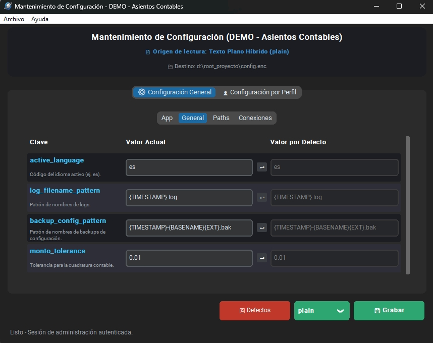
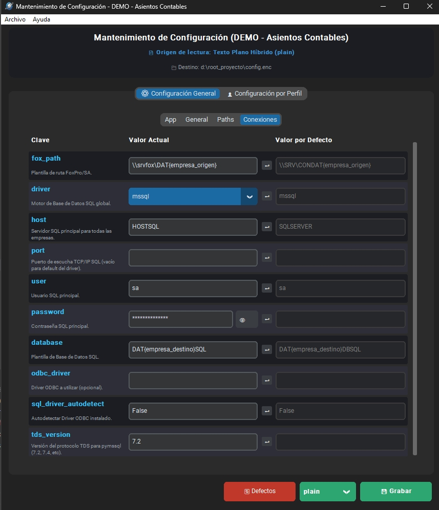
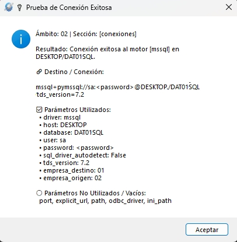
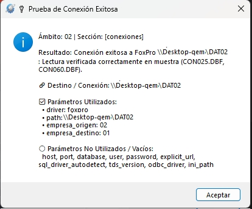
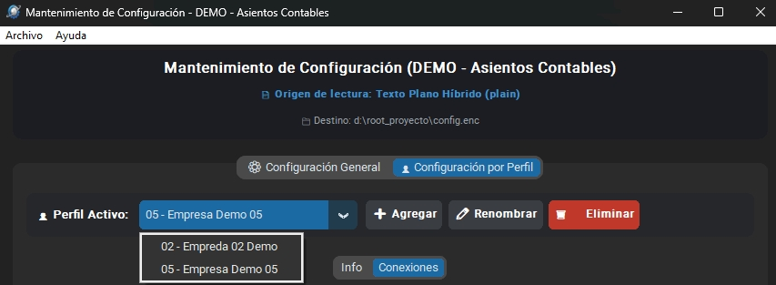
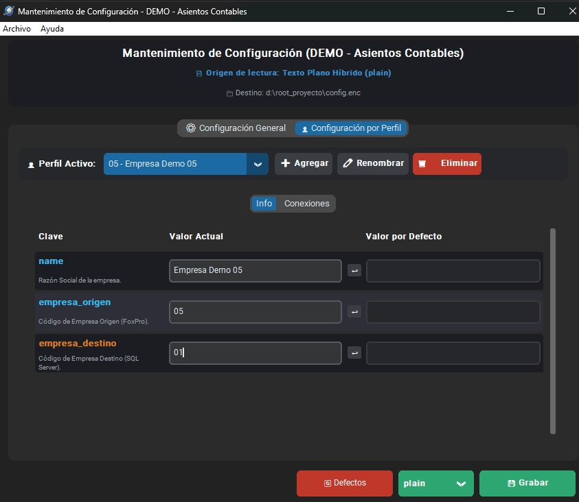
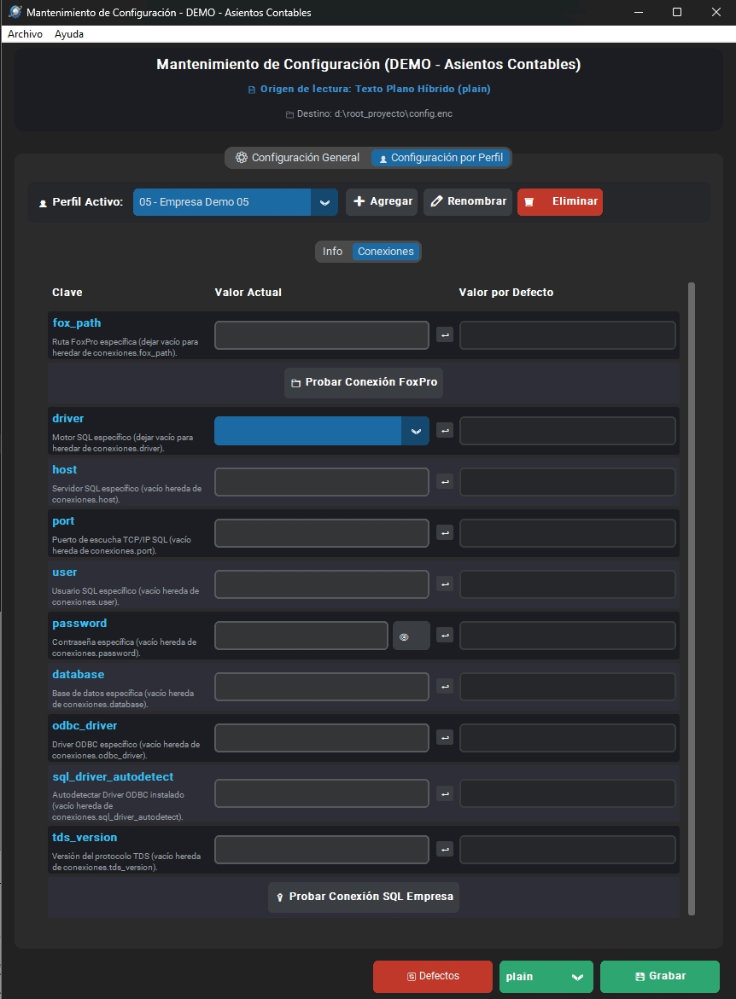
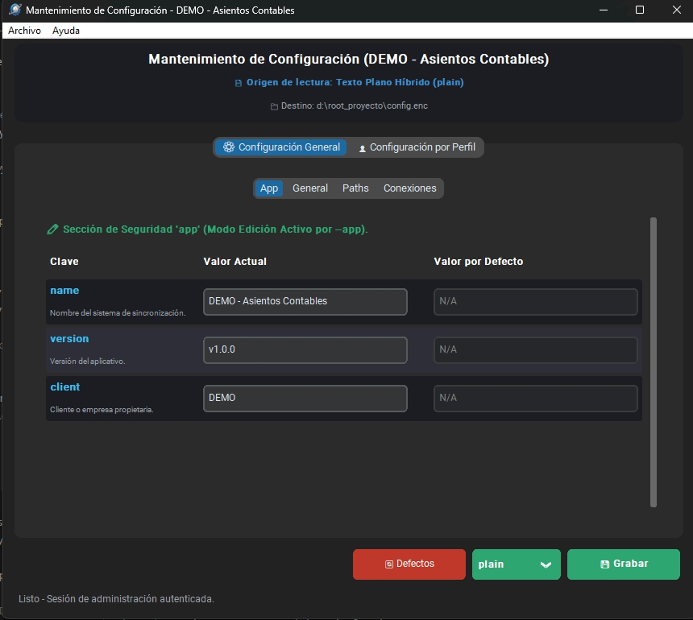

# ⚙️ pkg-asiscfg

[🇪🇸 Español](README.md) | [🇺🇸 English](README.en.md)

[](LICENSE) [](https://www.python.org/) [](#-arquitectura-y-principios-de-diseño-5-niveles-fail-fast) [](#-seguridad-y-criptografía)

Este paquete proporciona una solución de **gestión de configuraciones, validación estricta por esquemas y seguridad criptográfica** completa, centralizada, desacoplada, de ultra-alto rendimiento y sin sobrecarga en tiempo de ejecución para cualquier proyecto Python (aplicaciones de escritorio como PyQt/CustomTkinter, herramientas CLI, servicios en segundo plano o servidores web).

**pkg-asiscfg** es la infraestructura integral de gestión de configuraciones, validación por esquemas y seguridad criptográfica utilizada por las aplicaciones de la suite **Asisnet**.

--------------------------------------------------------------------------------

#### 📋 Tabla de Contenidos

1. [🎯 ¿Por qué pkg-asiscfg? (Propósito e Intención)](#-por-qué-pkg-asiscfg-propósito-e-intención)
2. [🚀 Capacidades y Características Clave](#-capacidades-y-características-clave)
3. [🖥️ Recorrido Visual de la Interfaz Administrativa](#️-recorrido-visual-de-la-interfaz-administrativa)
   - [1. Configuración General del Sistema](#1-configuración-general-del-sistema)
   - [2. Gestión Global de Conexiones](#2-gestión-global-de-conexiones)
   - [3. Pruebas de Conectividad en Tiempo Real (Integración con pkg-asisdb)](#3-pruebas-de-conectividad-en-tiempo-real-integración-con-pkg-asisdb)
   - [4. Selector y Gestión de Perfiles](#4-selector-y-gestión-de-perfiles)
   - [5. Configuración Detallada por Perfil](#5-configuración-detallada-por-perfil)
   - [6. Parámetros de Aplicación y Seguridad Administrativa](#6-parámetros-de-aplicación-y-seguridad-administrativa)
4. [📦 Instalación](#-instalación)
   - [1. Instalación Directa desde GitHub (Recomendado)](#1-instalación-directa-desde-github-recomendado)
   - [2. Instalación desde el Código Fuente Local](#2-instalación-desde-el-código-fuente-local)
   - [3. Ejecución Inmediata del Ejemplo Portable (`demo/`)](#3-ejecución-inmediata-del-ejemplo-portable-demo)
5. [🏗️ Arquitectura y Principios de Diseño (5 Niveles Fail-Fast)](#️-arquitectura-y-principios-de-diseño-5-niveles-fail-fast)
6. [🔒 Seguridad y Criptografía](#-seguridad-y-criptografía)
   - [1. Motores Criptográficos Soportados (`FORMAT_MODES`)](#1-motores-criptográficos-soportados-format_modes)
   - [2. Sellado Forense en Modo PLAIN (`security_level: 1`)](#2-sellado-forense-en-modo-plain-security_level-1)
   - [3. Invariante Canónico de Contraseñas (`NULL_SENTINEL`)](#3-invariante-canónico-de-contraseñas-null_sentinel)
   - [4. Integridad y Recuperación de Clave (`KeyRecoveryDialog`)](#4-integridad-y-recuperación-de-clave-keyrecoverydialog)
7. [📁 Estructura Recomendada del Proyecto Consumidor](#-estructura-recomendada-del-proyecto-consumidor)
8. [🛠️ Guía Rápida para Desarrolladores](#️-guía-rápida-para-desarrolladores)
   - [1. Definición del Esquema (`config_schema.py`)](#1-definición-del-esquema-config_schemapy)
   - [2. Anatomía y Estructura del Archivo Físico (`.cfg`)](#2-anatomía-y-estructura-del-archivo-físico-cfg)
   - [3. Inicialización en la Aplicación Cliente (Paso 0)](#3-inicialización-en-la-aplicación-cliente-paso-0)
9. [💻 Consola y Operación Administrativa (CLI)](#-consola-y-operación-administrativa-cli)
   - [Tabla de Parámetros CLI Canónicos](#tabla-de-parámetros-cli-canónicos)
10. [👥 Contacto y Soporte](#-contacto-y-soporte)
11. [📄 Licencia](#-licencia)

--------------------------------------------------------------------------------

#### 🎯 ¿Por qué pkg-asiscfg? (Propósito e Intención)

En el desarrollo de aplicaciones empresariales y de misión crítica, la gestión de la configuración suele convertirse en una **tarea repetitiva, tediosa y sumamente vulnerable**:
*   **Reinvención constante de código**: Cada nueva aplicación reinventa su propia rutina para leer y escribir archivos de configuración en disco.
*   **Credenciales expuestas en texto plano**: Las contraseñas de bases de datos y servicios quedan expuestas o protegidas con ofuscaciones frágiles y fácilmente reversibles.
*   **Validaciones dispersas y fallos tardíos**: La comprobación de tipos, rangos y valores obligatorios se dispersa a lo largo del código de negocio, generando caídas inesperadas en producción.
*   **Refactorizaciones costosas ante múltiples perfiles**: La incorporación de esquemas multisucursal, multiempresa o multi-entorno obliga a reestructurar aplicaciones completas.
*   **Alteraciones manuales y corrupción silenciosa**: La edición manual de archivos por parte de usuarios o técnicos suele corromper parámetros críticos sin dejar rastro ni auditoría forense.

**`pkg-asiscfg` esta diseñado para erradicar definitivamente estos problemas**, proveyendo una solución **llave en mano, modular, resiliente y de alto rendimiento**:
1.  **Paso 0 en 1 sola línea (`init_app_config`)**: Resuelve rutas físicas, valida esquemas, descifra claves y entrega la configuración estructurada e inmutable lista para consumo inmediato.
2.  **Seguridad Determinista al 100%**: Cero credenciales en texto claro, invariante canónico para contraseñas vacías, detección temprana de manipulaciones (*fail-fast*) y soporte para motores criptográficos industriales (AES-256-GCM, ChaCha20, Fernet).
3.  **Máximo Rendimiento ($O(1)$)**: Consumo en memoria ultra-liviano mediante objetos con `__slots__`, sin sobrecarga de CPU ni dependencias innecesarias en tiempo de ejecución.
4.  **Administración Visual Desacoplada (*Cold Path*)**: Interfaz gráfica de escritorio moderna para técnicos y administradores que jamás penaliza la memoria RAM ni el arranque de las aplicaciones cliente.

--------------------------------------------------------------------------------

#### 🚀 Capacidades y Características Clave

*   **Inicialización Unificada "Paso 0" (`init_app_config`)**: Inicia la configuración de cualquier aplicación anfitriona en una única llamada tipada que retorna un objeto estructurado inmutable (`ConfigBootstrap`).
*   **Aislamiento Radical de la UI (*Cold Path*)**: La interfaz gráfica (`customtkinter`) reside en una ruta fría; en modo de consumo (`consume`), la UI jamás se importa en `sys.modules`, garantizando cero impacto en memoria RAM y tiempo de arranque instantáneo.
*   **Consultas Directas en Tiempo Constante ($O(1)$)**: Métodos de alta frecuencia (`valor`, `valorpass`, `valor_profile`, `valorpass_profile`, `valor_parent`, `valorpass_parent`) optimizados con `__slots__` y resolución directa en memoria.
*   **Desencriptación JIT y Cero Contraseñas en Claro**: Las contraseñas se descifran en caliente (*Just-In-Time*) únicamente al invocar `valorpass*()`.
*   **Invariante Canónico `NULL_SENTINEL`**: Las contraseñas vacías se persisten cifradas bajo el token `<%null$>` y se entregan al consumidor como cadena vacía `""`. Jamás se almacena una contraseña en texto plano.
*   **Detección Estricta de 4 Fallas en Contraseñas**: Falla de inmediato (*fail-fast*) si un campo protegido no existe, carece del prefijo `ENC:`, está vacío o tiene un token criptográfico corrupto.
*   **Gestión Declarativa de Parámetros CLI (`app_help`)**: Permite a la aplicación anfitriona declarar sus opciones CLI con validación automática de tipos (`int`, `float`, `bool`, `str`), obligatoriedad (`required`) y listas de opciones (`choices`), con soporte simétrico para prefijos `/`, `-` y `--`.
*   **Cero Fugas de Argumentos**: Los argumentos posicionales del ejecutable anfitrión (ej. parámetros de invocación sin prefijo) se preservan intactos y aislados en `boot.remaining_args`.
*   **Sellado Forense en Modo PLAIN (`security_level: 1`)**: Permite archivos en formato legible pero sella un snapshot cifrado `_NO_MODIFICAR_NO_MODIFY`. Cualquier modificación externa en disco es detectada, auditada en bitácora (`[AUDIT-TAMPER]`) y advertida en la UI mediante `DiffWarningDialog`.
*   **Recuperación Interactiva de Clave (`KeyRecoveryDialog`)**: Si la clave criptográfica física (`.key`) se pierde o corrompe, el sistema bloquea el acceso en producción o permite su restauración guiada / regeneración controlada en modo administrativo.
*   **Metadatos Públicos Legibles (`# public`)**: Campos marcados como públicos se serializan al inicio del archivo físico como comentarios informativos `# <key>: <valor>` legibles en cualquier editor de texto, aun cuando el contenido esté 100% cifrado.
*   **Localización i18n Integrada**: Soporte nativo para descripciones traducibles en el esquema mediante el prefijo `t18n#` en integración directa con `pkg-i18n`.
*   **Despliegue Automatizado (`--install`)**: Flag de instalación que inicializa automáticamente la clave y la configuración con valores por defecto en despliegues desatendidos.

--------------------------------------------------------------------------------

#### 🖥️ Recorrido Visual de la Interfaz Administrativa

La herramienta administrativa de `pkg-asiscfg` ofrece un entorno visual intuitivo y moderno para configurar todos los aspectos del sistema de forma segura:

##### 1. Configuración General del Sistema
Parámetros globales de la empresa, rutas de trabajo y preferencias operativas centrales.


--------------------------------------------------------------------------------

##### 2. Gestión Global de Conexiones
Administración centralizada de motores de base de datos, puertos, instancias y credenciales de acceso con verificación en caliente.


--------------------------------------------------------------------------------

##### 3. Pruebas de Conectividad en Tiempo Real (Integración con `pkg-asisdb`)
Validación instantánea de credenciales y rutas tanto para motores relacionales (SQL Server, PostgreSQL, MySQL, Oracle, SQLite) como para almacenes de datos locales o de red (FoxPro / DBF).

| Verificación SQL Server | Verificación FoxPro / DBF |
| :---: | :---: |
|  |  |

###### ¿Cómo Funciona el Test de Conexión?
Al pulsar el botón de prueba en la interfaz gráfica:
1.  **Recopilación en Caliente**: La UI sincroniza los campos activos en pantalla sin necesidad de guardar previamente el archivo en disco.
2.  **Desencriptación Segura Just-In-Time**: Las contraseñas protegidas (`is_password: True`) se desencriptan efímeramente en memoria para la prueba sin exponerlas en texto claro.
3.  **Resolución e Interpolación de Comodines**: Se resuelven los comodines dinámicos (como `[empresa_destino]` o `{ROOT}`) configurados en nombres de base de datos o rutas físicas.
4.  **Delegación en `pkg-asisdb`**: Se invoca `asisdb.engine.test_connection(driver=driver, **other_params)`, la cual valida la conectividad física, autenticación y acceso a los datos.
5.  **Diagnóstico y Reporte**: Se despliega una ventana modal con el veredicto (éxito o causa exacta de la falla), los parámetros utilizados, parámetros omitidos y la URL generada (manteniendo las contraseñas protegidas).

###### ¿Cómo se Configura en el Esquema (`config_schema.py`)?
Los botones de prueba se declaran como un campo con `"type": "test_connection"` y una directiva `"mapping"` que vincula los parámetros del driver con los campos de la interfaz:

```python
# Botón de prueba en perfil con herencia en cascada (Perfil -> Global)
"btn_test_db": {
    "type": "test_connection",
    "description": "t18n#🔌 Probar Conexión Perfil",
    "mapping": {
        "driver": ["driver", "database.driver"],       # Cascada: Perfil -> Global (sqlite)
        "database": ["database", "database.database"], # Cascada: demo_01.db -> demo_{profile}.db
        "user": ["user", "database.user"],             # Cascada: Perfil -> Global (admin_general)
        "password": ["password", "database.password"]  # Cascada: Perfil -> Global (desencriptado JIT)
    }
},

# Botón de prueba en sección global con valor literal fijo
"btn_test_db_global": {
    "type": "test_connection",
    "description": "t18n#🔌 Probar Conexión Global",
    "mapping": {
        "driver": "database.driver",
        "database": LITERAL("demo_global.db"),         # Literal fijo inmutable
        "user": "database.user",
        "password": "database.password"
    }
}
```

**Reglas de Resolución de Parámetros en el `mapping`**:
*   **Resolución en Cascada (Lista)**: `["driver", "database.driver"]` o `["password", "database.password"]`. El botón de prueba evalúa la lista en orden: busca primero en el perfil activo; si está vacío, recurre al valor configurado en la sección global padre.
*   **Valores Fijos / Literales**: `LITERAL("demo_global.db")` o `"literal:sqlite"`. Fija el driver o parámetro sin requerir un campo de entrada en la interfaz.
*   **Comodines Dinámicos**: Permite definir plantillas como `demo_{profile}.db` o `DAT[empresa_destino]SQL` que se resuelven en tiempo real según el perfil activo.
*   **Drivers Soportados**: `sqlite`, `mssql` (SQL Server), `postgres` (PostgreSQL), `mysql` (MySQL / MariaDB), `oracle` y `foxpro` (Visual FoxPro / Tablas DBF).

--------------------------------------------------------------------------------

##### 4. Selector y Gestión de Perfiles
Soporte nativo para múltiples perfiles (sucursales, empresas, entornos o esquemas de trabajo independientes), con sincronización automática y ordenación alfabética.


--------------------------------------------------------------------------------

##### 5. Configuración Detallada por Perfil
Cada perfil dispone de su propia identidad empresarial y sus conexiones de base de datos específicas:

| Datos e Información del Perfil | Conexiones de Base de Datos por Perfil |
| :---: | :---: |
|  |  |

--------------------------------------------------------------------------------

##### 6. Parámetros de Aplicación y Seguridad Administrativa
Sección protegida con elevación UAC y control de acceso administrativo para configurar parámetros de identidad y propios de la aplicación.


--------------------------------------------------------------------------------

#### 📦 Instalación

##### 1. Instalación Directa desde GitHub (Recomendado)
Instalación en el entorno virtual mediante `pip`:
```powershell
pip install git+https://github.com/borispinto/pkg-asiscfg.git
```

O declarándolo en tu archivo `requirements.txt`:
```text
pkg-asiscfg @ git+https://github.com/borispinto/pkg-asiscfg.git
```

O en tu archivo `pyproject.toml`:
```toml
[project]
dependencies = [
    "pkg-asiscfg>=1.0.0",
]
```

--------------------------------------------------------------------------------

##### 2. Instalación desde el Código Fuente Local
Clonación e instalación estándar:
```powershell
git clone https://github.com/borispinto/pkg-asiscfg.git
cd pkg-asiscfg
pip install .
```

O en modo editable para desarrollo:
```powershell
pip install -e .
```

--------------------------------------------------------------------------------

##### 3. Ejecución Inmediata del Ejemplo Portable (`demo/`)
El repositorio incluye un ejemplo completo, autónomo y preconfigurado con SQLite y multi-perfil (`01` y `02`) dentro del directorio `demo/`, listo para ejecutar inmediatamente sin necesidad de configurar servidores de bases de datos externos:

```powershell
# 1. Clonar el repositorio y acceder al proyecto
git clone https://github.com/borispinto/pkg-asiscfg.git
cd pkg-asiscfg

# 2. Instalar el paquete en modo editable
pip install -e .

# 3. Ejecutar la interfaz gráfica interactiva en modo desarrollo
python demo/demo.py --ui --dev
```

>[!TIP]
>**Modo Consola**: Para inspeccionar en terminal cómo se inicializa la configuración, cómo se consultan parámetros globales y cómo opera la herencia jerárquica en cascada (`valor_parent` y `valorpass_parent`), ejecuta directamente:
>```powershell
>python demo/demo.py
>```

>[!NOTE]
>**Requisitos de Entorno y Ecosistema**:
>*   **Modo Consumo (Servicios / Producción)**: Solo requiere `cryptography>=3.0` (incluida en las dependencias estándar del paquete). La interfaz gráfica no se importa ni se carga en memoria.
>*   **Modo Administración Visual (`--ui`)**: Requiere soporte de entorno gráfico de escritorio (`customtkinter` y `Pillow`).
>*   **Funcionamiento Integral al 100%**:
>    *   **`pkg-asisdb`**: Librería de infraestructura de datos necesaria para ejecutar las pruebas activas de conectividad a bases de datos (`test_connection`) en la interfaz gráfica.
>    *   **`pkg-i18n`**: Librería requerida para la traducción dinámica de descripciones y etiquetas en esquemas de configuración con prefijo `t18n#`.

--------------------------------------------------------------------------------

#### 🏗️ Arquitectura y Principios de Diseño (5 Niveles Fail-Fast)

El paquete está diseñado bajo una estricta jerarquía de 5 niveles secuenciales donde cada nivel garantiza al 100% su contrato, eliminando código defensivo redundante entre capas:

| Nivel | Componente / Capa | Responsabilidad y Principio Fail-Fast |
| :---: | :--- | :--- |
| **1** | **CLI & Parsing** (`asiscfg.cli`) | Validación sintáctica determinista, casting de tipos y aislamiento estricto de argumentos posicionales anfitriones (`remaining_args`). |
| **2** | **Contexto & Criptografía** (`asiscfg.context`, `asiscfg.crypto`) | Resolución determinista de rutas absolutas, verificación de clave física en RAM y selección del motor criptográfico ($O(1)$). |
| **3** | **Persistencia & Esquema** (`asiscfg.schema`, `asiscfg.storage`) | Validación estructural contra `CONFIG_SCHEMA`, serialización de metadatos públicos (`# public`), sellado forense y detección de las 4 fallas de contraseñas. |
| **4** | **Estructura en Memoria** (`asiscfg.models`) | Modelos `ConfigDict` y `ConfigBootstrap` optimizados con `__slots__ = True` para consumo mínimo de memoria RAM y cero overhead. |
| **5** | **Entrega de Datos** (`ConfigDict.valor*`) | Consultas directas en tiempo constante ($O(1)$) y desencriptación JIT (*Just-In-Time*) de contraseñas únicamente al invocar `valorpass*`. |

##### Principios de Diseño Rectores
1.  **Seguridad Determinista**: Cero tolerancia a fallos silenciosos. Si un campo protegido es manipulado indebidamente, el sistema interrumpe inmediatamente la ejecución en modo de producción (*Fail-Fast*).
2.  **Dualidad Arquitectónica (*Cold Path*)**: La interfaz gráfica administrativa (`asiscfg.ui`) solo se carga bajo demanda; en modo `consume`, las librerías gráficas (`tkinter`, `customtkinter`) jamás residen en `sys.modules`.
3.  **Inviolabilidad de la Eficiencia en Producción**: El código de producción no implementa fallbacks lentos ni código defensivo redundante para facilitar pruebas; la suite de tests se adapta rigurosamente a los contratos óptimos de producción.

--------------------------------------------------------------------------------

#### 🔒 Seguridad y Criptografía

La seguridad en `pkg-asiscfg` es **100% determinista** y aplica el principio de *Fail-Fast*: ante cualquier manipulación, inconsistencia o credencial inválida, el sistema interrumpe la ejecución inmediatamente en modo de producción para proteger la integridad de los datos de negocio.

##### 1. Motores Criptográficos Soportados (`FORMAT_MODES`)

| Motor | Identificador | Características Criptográficas | Escenario Recomendado |
| :--- | :--- | :--- | :--- |
| **Plain** | `plain` | Formato JSON legible con cifrado campo a campo para contraseñas. Admite sellado forense. | Desarrollo, depuración y auditoría directa. |
| **Fernet** | `fernet` | Cifrado completo autenticado simétrico (AES-128-CBC + HMAC-SHA256). | Producción estándar multiplataforma. |
| **AES-256-GCM** | `aes256_gcm` | Cifrado autenticado de grado militar de 256 bits acelerado por hardware (AES-NI). | Producción de misión crítica y alto volumen. |
| **ChaCha20** | `chacha20` | Cifrado autenticado de flujo Poly1305 de 256 bits. Ultra eficiente en CPUs sin AES-NI. | Entornos embebidos, virtualizados o móviles. |

##### 2. Sellado Forense en Modo PLAIN (`security_level: 1`)
En formato `plain`, el parámetro `_security_level: 1` sella un snapshot forense cifrado bajo la directiva `@NO_MODIFICAR_NO_MODIFY`. Si un técnico o usuario altera manualmente parámetros en el archivo físico:
*   En **producción**, la diferencia se registra inmediatamente en la bitácora de auditoría (`[AUDIT-TAMPER]`).
*   En la **interfaz administrativa (`--ui`)**, se despliega el diálogo modal `DiffWarningDialog` mostrando con precisión qué claves fueron modificadas externamente, su valor original sellado y el valor actual en disco.

##### 3. Invariante Canónico de Contraseñas (`NULL_SENTINEL`)
*   Las contraseñas vacías **nunca se guardan en texto plano** ni se asumen por omisión.
*   Se persisten cifradas bajo el token canónico `NULL_SENTINEL` (`"<%null$>"`). Al descifrarse mediante `valorpass*()`, se entregan al consumidor como cadena vacía `""`.
*   **4 Condiciones de Falla Canónica**: Si un campo marcado con `is_password: True` (1) no existe, (2) carece del prefijo `ENC:`, (3) carece de cuerpo de token o (4) falla el descifrado por clave incorrecta o alterada, la ejecución se detiene de inmediato en modo de producción (`ValueError`).

##### 4. Integridad y Recuperación de Clave (`KeyRecoveryDialog`)
Al iniciar, se verifica exhaustivamente la presencia y compatibilidad del archivo `.key`. Si el archivo de clave fue extraviado o reemplazado por una clave ajena:
*   En **producción**, detiene la ejecución inmediatamente.
*   En **modo administrativo con elevación (`--dev` o Administrador)**, despliega el asistente interactivo de recuperación para:
    1.  Localizar y restaurar una copia de respaldo válida del archivo `.key`.
    2.  Regenerar una nueva clave con reinicialización segura a los valores por defecto del esquema.

--------------------------------------------------------------------------------

#### 📁 Estructura Recomendada del Proyecto Consumidor

```text
mi_proyecto/
├── pyproject.toml / requirements.txt  # Declara dependencia a pkg-asiscfg
├── demo.cfg                           # Archivo físico de configuración (cifrado o plain)
├── demo.key                           # Clave criptográfica física (en producción)
└── demo/
    ├── core/
    │   └── config_schema.py           # Definición canónica de estructura y validaciones
    └── demo.py                        # Inicialización Paso 0: init_app_config(...)
```

>[!NOTE]
>`pkg-asiscfg` resuelve las rutas físicas de manera determinista: busca primero en el directorio de trabajo actual o junto al ejecutable (`sys.executable` si está congelado con PyInstaller). Los archivos `.cfg` y `.key` siempre residen en el sistema de archivos del anfitrión.

--------------------------------------------------------------------------------

#### 🛠️ Guía Rápida para Desarrolladores

##### 1. Definición del Esquema (`config_schema.py`)
Crea un archivo `config_schema.py` en tu proyecto definiendo la estructura, tipos, validaciones y perfiles:

```python
  1 # demo/core/config_schema.py
  2 from asiscfg import LITERAL
  3 
  4 CONFIG_SCHEMA = {
  5     # ── Políticas de Configuración ──
  6     "_security_level": 1,
  7     "_backup": {
  8         "enabled": True,
  9         "method": "timestamp",
 10         "target_dir": "{ROOT}/backups",
 11         "filename_pattern": "{TIMESTAMP}-{BASENAME}{EXT}.bak",
 12         "max_backups": 20
 13     },
 14 
 15     # ── 1. Sección de Aplicación y Seguridad ──
 16     "app": {
 17         "nombre": {
 18             "type": "str",
 19             "default": "Demo Conector Empresarial",
 20             "description": "Nombre de la Aplicación",
 21             "public": True
 22         },
 23         "version": {
 24             "type": "str",
 25             "default": "1.0.0",
 26             "description": "Versión del Software",
 27             "public": True
 28         },
 29         "debug": {
 30             "type": "bool",
 31             "default": False,
 32             "description": "Habilitar Modo Depuración"
 33         }
 34     },
 35 
 36     # ── 2. Sección General de Negocio ──
 37     "general": {
 38         "idioma": {
 39             "type": "str",
 40             "default": "es",
 41             "description": "Código de Idioma Activo",
 42             "public": True
 43         },
 44         "empresa": {
 45             "type": "str",
 46             "default": "Corporación Demo C.A.",
 47             "description": "Nombre de la Empresa",
 48             "public": True
 49         }
 50     },
 51 
 52     # ── 3. Sección Global (Padre): Base de Datos Compartida ──
 53     "database": {
 54         "driver": {
 55             "type": "str",
 56             "default": "sqlite",
 57             "description": "Motor de Base de Datos Global",
 58             "public": True
 59         },
 60         "database": {
 61             "type": "str",
 62             "default": "demo_{profile}.db",
 63             "description": "Archivo de BD Global"
 64         },
 65         "user": {
 66             "type": "str",
 67             "default": "admin_general",
 68             "description": "Usuario Global por Defecto"
 69         },
 70         "password": {
 71             "type": "str",
 72             "default": "ClaveGlobal123",
 73             "is_password": True,
 74             "description": "Contraseña Global por Defecto"
 75         },
 76         "btn_test_db_global": {
 77             "type": "test_connection",
 78             "description": "🔌 Probar Conexión Global",
 79             "mapping": {
 80                 "driver": "database.driver",
 81                 "database": LITERAL("demo_global.db"),
 82                 "user": "database.user",
 83                 "password": "database.password"
 84             }
 85         }
 86     },
 87 
 88     # ── 4. Sección Multiperfil (@profiles): Sucursales y Herencia ──
 89     "@profiles": {
 90         "_template": {
 91             "info": {
 92                 "nombre": {
 93                     "type": "str",
 94                     "default": "",
 95                     "description": "Nombre de la Sucursal",
 96                     "public": True
 97                 },
 98                 "codigo": {
 99                     "type": "str",
100                     "default": "01",
101                     "description": "Código de Sucursal"
102                 }
103             },
104             "database": {
105                 "driver": {
106                     "type": "str",
107                     "default": "",
108                     "description": "Motor (vacío = hereda del padre global)"
109                 },
110                 "database": {
111                     "type": "str",
112                     "default": "",
113                     "description": "Archivo de BD del Perfil (vacío = hereda)"
114                 },
115                 "user": {
116                     "type": "str",
117                     "default": "",
118                     "description": "Usuario (vacío = hereda del padre global)"
119                 },
120                 "password": {
121                     "type": "str",
122                     "default": "",
123                     "is_password": True,
124                     "description": "Contraseña (vacía = hereda del padre global)"
125                 },
126                 "btn_test_db": {
127                     "type": "test_connection",
128                     "description": "🔌 Probar Conexión Perfil",
129                     "mapping": {
130                         "driver": ["driver", "database.driver"],
131                         "database": ["database", "database.database"],
132                         "user": ["user", "database.user"],
133                         "password": ["password", "database.password"]
134                     }
135                 }
136             }
137         },
138         # Perfil 01: Sucursal Principal en Caracas
139         "01": {
140             "info": {
141                 "nombre": "Sucursal Principal",
142                 "codigo": "01"
143             },
144             "database": {
145                 "database": "demo_01.db"
146             }
147         },
148         # Perfil 02: Sucursal Secundaria con usuario propio
149         "02": {
150             "info": {
151                 "nombre": "Sucursal Secundaria",
152                 "codigo": "02"
153             },
154             "database": {
155                 "user": "supervisor_sucursal_02"
156             }
157         }
158     }
159 }
```

##### Desglose y Explicación del Esquema:

El esquema declarativo actúa como el contrato maestro de validación, renderizado en UI y persistencia física en disco. A continuación se desglosan las líneas del código anterior, sus directivas y las reglas de cada elemento:

| Elemento / Directiva | Tipo / Rol en Esquema | Propósito y Reglas de Declaración |
| :--- | :--- | :--- |
| **`LITERAL`**<br>*(Línea 2)* | Import Helper | Función canónica importada desde `asiscfg` para fijar valores literales estáticos en directivas `mapping` (como `LITERAL("demo_global.db")` en línea 81) sin vincularlos a controles de entrada editables de la interfaz gráfica. |
| **`CONFIG_SCHEMA`**<br>*(Línea 4)* | Diccionario Raíz | Objeto raíz que define la totalidad del contrato: políticas globales, secciones escalares, secciones de seguridad y módulos multiperfil. |
| **`_security_level`**<br>*(Línea 6)* | Directiva Raíz de Sellado | Nivel de integridad del archivo. Con valor `1` en formato `PLAIN`, instruye al motor a calcular y persistir el snapshot forense cifrado bajo `@NO_MODIFICAR_NO_MODIFY`. Cualquier alteración manual no autorizada fuera de la UI dispara auditoría `[AUDIT-TAMPER]` y el diálogo de diferencias `DiffWarningDialog`. |
| **`_backup`**<br>*(Líneas 7 a 13)* | Directiva Raíz de Respaldos | Política de respaldo automático previa a cada guardado. Define activación (`enabled: True`), estrategia (`method: "timestamp"`), directorio de almacenamiento con comodín (`target_dir: "{ROOT}/backups"`), patrón de nombrado y retención histórica (`max_backups: 20`). |
| **`"app"`**<br>*(Líneas 16 a 34)* | Sección Canónica de Seguridad | Aloja la identidad y metadatos del aplicativo (`nombre`, `version`, `debug`). Sus campos se persisten en disco cifrados con Fernet (`ENC:`) y en la interfaz gráfica se muestran como solo lectura (salvo si se invoca con `--edit`). |
| **`public: True`**<br>*(Líneas 21, 27, 42, 49, 58, 96)* | Atributo de Visibilidad Pública | Expone el valor del campo como comentario `# public` en la cabecera física del archivo `.cfg`. Permite a técnicos y herramientas de monitoreo inspeccionar datos clave abriendo el archivo en cualquier editor de texto plano (Notepad) sin descifrar el archivo. Incompatible con `is_password`. |
| **`"general"`**<br>*(Líneas 37 a 50)* | Sección Libre / Personalizada | Sección de negocio definida para este ejemplo para clasificar parámetros según la necesidad del proyecto (`idioma`, `empresa`). En `asiscfg`, los nombres y contenidos de estas secciones son completamente abiertos y adaptables a cada proyecto; sus claves pueden o no participar en la herencia según el uso de las funciones `valor*` en la aplicación anfitriona. |
| **`"database"`**<br>*(Líneas 53 a 86)* | Sección Libre / Personalizada | Otra sección definida libremente para este ejemplo para estructurar datos de conexión compartidos (`driver`, `database`, `user`, `password`). Al igual que `"general"`, sus claves actúan como origen padre para herencia en cascada si y solo si se consultan mediante `valor_parent*`, o como valores globales independientes al consultarse con `valor*`. |
| **`is_password: True`**<br>*(Líneas 73 y 123)* | Atributo de Protección Criptográfica | Marca campos sensibles que se cifran obligatoriamente con Fernet bajo el prefijo `ENC:`. En la UI se muestran con máscara (`••••••`) y nunca se exponen en texto claro. Si se dejan vacíos, se almacenan como `NULL_SENTINEL`. |
| **`btn_test_db_global`**<br>*(Líneas 76 a 85)* | Botón de Prueba Global | Campo `"type": "test_connection"`. Renderiza un botón interactivo en la UI para validar conectividad. Su directiva `mapping` enlaza parámetros de conexión con campos del esquema y valores inmutables fijados con `LITERAL`. |
| **`"@profiles"`**<br>*(Líneas 89 a 158)* | Módulo Canónico Multi-Perfil | Contenedor para perfiles o variantes contextuales independientes (ej. sucursales, empresas, entornos de ejecución, conexiones o terminales). Declara la plantilla obligatoria `_template` y las instancias concretas de perfiles creadas por defecto (`"01"` y `"02"`). |
| **`"_template"`**<br>*(Líneas 90 a 136)* | Plantilla Estructural Obligatoria | Especifica la jerarquía interna de cada perfil (`info` y `database`). Si un campo se declara con default `""`, no hereda por defecto; habilita la herencia en cascada únicamente si el código cliente invoca `valor_parent()` o `valorpass_parent()`. Por defecto, la herencia resuelve hacia la misma ruta de clave en la raíz global (`key_path_parent = key_path`), pero puede redirigirse hacia **cualquier otra sección o clave arbitraria** mediante el parámetro opcional `key_path_parent`. |
| **`btn_test_db` en Perfil**<br>*(Líneas 126 a 135)* | Botón de Prueba con Fallback | Botón `test_connection` cuya directiva `mapping` utiliza listas de resolución jerárquica (ej. `["driver", "database.driver"]`). Evalúa primero si el perfil define un valor local y, si está vacío, recurre automáticamente a la sección padre global. |
| **Perfiles Concretos `"01"` y `"02"`**<br>*(Líneas 138 a 157)* | Instancias de Perfil (100% Opcionales) | **100% Opcionales**: Se definen en el esquema únicamente si se desea sembrar perfiles con valores por defecto al momento de inicializar el archivo por primera vez. Si se omiten, la configuración puede crearse sin perfiles iniciales (creándose luego dinámicamente vía UI o API). En este ejemplo, ilustran cómo `"01"` sobrescribe `database: "demo_01.db"` y `"02"` sobrescribe `user: "supervisor_sucursal_02"`, delegando el resto al padre si se consulta con `valor_parent*`. |

--------------------------------------------------------------------------------

##### 2. Anatomía y Estructura del Archivo Físico (`.cfg`)

A continuación se presenta el contenido real de un archivo de configuración generado por `pkg-asiscfg` ([`demo/demo.cfg`](demo/demo.cfg)) en formato `PLAIN` con sellado forense y campos protegidos:

```ini
 1 # ASISCFG_PLAIN
 2 # app.nombre: Demo Conector Empresarial
 3 # app.version: 1.0.0
 4 # general.idioma: es
 5 # general.empresa: Corporación Demo C.A.
 6 # database.driver: sqlite
 7 # @profiles.01.info.nombre: Sucursal Principal
 8 # @profiles.02.info.nombre: Sucursal Secundaria
 9 {
10     "app": {
11         "nombre": "ENC:gAAAAABq1rBTc9T3yzBo90eBWuFHfUc844-HqcPZkl6ngjR-iLEuVBYUfrv-zlO8_VG-3W7HPJJCMSeZxw2RjlLyqce-U0oB-L2RAytNAqIabtdkvYLwU9U=",
12         "version": "ENC:gAAAAABq1rBTYqjn5V3AwhpkboWBlrJWt9UHRL61sYvQ1Qif1z9vZu1UcE9VSYDsPKyAMEdA780aXS1xXHa0FRklYuSMuQ0Vkg==",
13         "debug": "ENC:gAAAAABq1rBT5JOyHV9-MaZL9aT-nv6SEV7M-TUudkleQ0Yg_OLpvwd2EN2RAr3DqxN-Yo9WLYPkOFJ45JoZ3ADXedSiz1_s5g=="
14     },
15     "general": {
16         "idioma": "es",
17         "empresa": "Corporación Demo C.A."
18     },
19     "database": {
20         "driver": "sqlite",
21         "database": "demo_{profile}.db",
22         "user": "admin_general",
23         "password": "ENC:gAAAAABq1rAX2IrvJuYS0mSPX3eiLj2a9IuTq8UpZUNOVwelCY_vPXbk9P3YUREkbdiooeSPh8EBsM1gGFKKpegP9IFB24BXLA=="
24     },
25     "@profiles": {
26         "01": {
27             "info": {
28                 "nombre": "Sucursal Principal",
29                 "codigo": "01"
30             },
31             "database": {
32                 "driver": "",
33                 "database": "demo_01.db",
34                 "user": "",
35                 "password": "ENC:gAAAAABq1rBTifBoK1JtpMYhPcWWI5_i08ek_6uZtj9lfFn5eueRxJLmpkDiClEv86r5KdEDNeb3yo6IwtzJjQTruJQjVuThCw=="
36             }
37         },
38         "02": {
39             "info": {
40                 "nombre": "Sucursal Secundaria",
41                 "codigo": "02"
42             },
43             "database": {
44                 "driver": "",
45                 "database": "",
46                 "user": "supervisor_sucursal_02",
47                 "password": "ENC:gAAAAABq1rBTMDEwsiBIl9EoyoVrxq-kpZfKfKtuxVtumu4ViRePJiMHsSDcDuzAEHdI4crflEuPvMGxbO6xG8-HisNjlXA5DQ=="
48             }
49         }
50     },
51     "@asiscfg": {
52         "admin_pass_hash": "2a97516c354b68848cdbd8f54a226a0a55b21ed138e207ad6c5cbb9c00aa5aea"
53     },
54     "@NO_MODIFICAR_NO_MODIFY": "gAAAAABq1rBTnfJ2w7oEx5QlYD9ba3tgOP6Beuzxv0W6SlxY0MIpPxi2wi97JrhsvuMyoAWY1K6DmkoCtWJJ6P75RwkBSd1nGogiB4d3jd3c-zFgXVCgbhDrC_mwaGweiRVlmxoQ1Z6U74ZdRPn0kwFH9QWnC3uZU8EUqebOzW98tnPZVG_x_eBK2xnxQ_mpbtsNaaPBjTqzUWH0TwiZ5Piv8kWF1aogqEstrSw0HpaxS3NoA5aDMbUp4FTzzsIFGkcCdQjVzAYHKb9PAeFzqcCBUl9xkw5CoFD1w4qhwUo-KzR01pcpV_Jbur75rvvxBDazot1u6Lj1LbOlAAqRbqCOGfSYsyFHWhLM0i-KTqbC_7Mq-ggsG3-g_RO31Js1Tx8KXdzIZ2hjhggZqxtbsTHZLgCiPypCo4z0_aMV8N55d0QiV_OS7NvmKcDOxuLi3AfSBM_CqjJ7Q0V52jIILKHxC0UXfLF6CSDSiXcBHutEqhVdnNUZbXdka9n5J-bp-6DlLtBoN_OC6DuSfgSXxXAOfEvwS_HRPdhO7S2ErNs1dD1txSk-25Xp1IXGgcEsm0uymY0VIkDT4oq1FSwshJH1e81NvyKu50kqlCfesaD-J5Cmq1auK3eAfaN3v9lIfrHLXCzo28rU55t91OkSNbCjZEvh3bJ1lLgXf88fAcbjYfGu-0DOKFGnbRW4aMsBg8ecAzFqL61xVRPkWgWhC3g8ly7QacWx3ZSJiNdz7hOAawXzdHf8s5k2_2LDlK6ygb66qc-wCQ0dRkGQqaUiGhXEODnUCrwq2R01gSPmNI0Y-OoMbDm-dRvdxr12XgKio8X7hqeDaddHgxZTNE1rN2xT92cT5thFXesIlOAASvjDsTyjIYzY-UR7bq2pQDCj3_ajMdGefUEJWueuh-_5FGiToOE1QAl7Q6EtzcaV6Zm11bhi8GJgbZ3mkYm6umU_jGDo58oWm7XsL-uYz65FZ9WN19dThL8jnoILImcqU6BNIieTCmaTNR-Wit2NO3WIiULTRGsmSkwswSU6r0IggLJE_q_P0lvcXQapL7MWFhaYUcWqyJG5E2K0JwE4ifNgOGvlXeXXgiSqW1o0aHys94w-bP2h6g3P3rCi_nTQLsi_joKIGD_3Yq5zvXLxJ5nvweKkj2-88gqzZP2vmLQzNnCQyKKGPtd5YLioZug2_seacGnyc2IsVWM5FNoBfDdXmyb-FTwMpKulebxZK7dZP_cECBWOOsRPiX9obQ6ecpyQrz-QpjA0j7lZMfhnqhwK5sRyYLLbgNPqcsvPxo25lOKFjbq5tvSyxKixy-DmYhfdmynjVgBV4YDxwVKJmQirccaTb7DHbG1MgiHWlFFs-CkisaV-OufESAmNg6fT0AyT2XhI-1-pcPqcGTqjJWPOf3-7kkSjp1UushwE8_uEXd3E6bu6D9-3Pox1olIANfSxNHLAZ8s4quosJVi-Hy5bvntuiLmfy7YE9hoh7cE71u1i-mSrxpi8-C5dKp8EPGmvywsg4pCFbMJJhQOEAZCeSQysMLCdtHH8_N_TYovnoFiU2vGYy6-yclr3hqDVK6ODxLJR3iZ0keOmWc8riCuQMmEW_FsjIOuHa0qMywKp-BkArDhV6bbQMFMXhYqfmJ7C4eM-1-rJFIynKBN4KVNJ9VZqYkcE4SU5BOZvCuLIWISw7y2gTmrZgKRQOyJkrJaeJpN_5tttvbJhNDGlRMeKAVcMVrluKi_-IWSbcyUVyuBTwZzhvf8YYEOZk9aYx6POgThWHLarVlh8WBZ5Tl0TMETTwjVzqM_m"
55 }
```

##### Desglose de Secciones Canónicas y Reglas de Manipulación de Campos:

El archivo físico combina las directivas estructurales del motor `asiscfg` con los datos declarados en el esquema. A continuación se detallan las secciones canónicas y el comportamiento de cada tipo de campo al inspeccionar o editar el archivo en modo plano (`PLAIN`):

| Elemento / Campo | Tipo y Formato | Comportamiento y Reglas de Manipulación en Plano |
| :--- | :--- | :--- |
| **`# ASISCFG_PLAIN`**<br>*(Línea 1)* | Cabecera del Motor | **Inalterable**: Identifica de forma determinista en $O(1)$ el algoritmo criptográfico del archivo (`plain`, `fernet`, `aes256_gcm`, `chacha20`). Modificarla corrompe la carga del motor. |
| **`# public`**<br>*(Líneas 2 a 8)* | Comentarios Públicos | **Solo Lectura / Informativo**: Generados automáticamente a partir de los campos del esquema con `"public": True`. Permiten a técnicos y herramientas de monitoreo inspeccionar datos clave abriendo el archivo con cualquier visor de texto plano (Notepad) sin desencriptar el archivo ni exponer contraseñas (las contraseñas nunca se publican). |
| **`"app"`**<br>*(Líneas 10 a 14)* | Sección Canónica de Seguridad | **Protegida / Cifrada con `ENC:`**: Aloja la identidad y metadatos del aplicativo (`nombre`, `version`, `debug`). Para proteger la marca y evitar manipulación manual no autorizada en disco, sus valores se persisten cifrados con el prefijo `ENC:`. En la interfaz gráfica es de solo lectura (salvo con `--edit`). Alterar manualmente estos tokens en un editor de texto corrompe el descifrado determinista. |
| **Campos de Negocio en Texto Plano**<br>*(Líneas 15 a 22, 27 a 30, 39 a 42)* | Tipos nativos (`str`, `int`, `bool`, etc.) | **Editables en Plano**: Campos escalares estándar (ej. `idioma`, `empresa`, `driver`, `database`, `user`). Son directamente legibles y editables con cualquier editor de texto plano (Notepad). Si el esquema define `_security_level: 1`, cualquier modificación manual fuera de la UI es detectada por el sellado forense, generando una alerta de auditoría `[AUDIT-TAMPER]` y desplegando en la UI el diálogo `DiffWarningDialog` con las diferencias exactas entre disco y el snapshot original. |
| **Campos de Contraseña** (`is_password: True`)<br>*(Líneas 23, 35 y 47)* | Token Fernet con prefijo `ENC:` | **Estrictamente Inalterables en Plano**: Las contraseñas (ej. `password`) **nunca se guardan en texto plano**. Si un técnico intenta escribir una clave en texto claro dentro del archivo `.cfg` (omitiendo el cifrado o el prefijo `ENC:`), el sistema interrumpe el inicio de inmediato (*Fail-Fast*) con `ValueError`. Si la contraseña está vacía, se almacena cifrada bajo el token canónico `NULL_SENTINEL` (`"<%null$>"`). Toda actualización de contraseñas debe realizarse exclusivamente vía UI (`--ui`) o API programática. |
| **`"@profiles"`**<br>*(Líneas 25 a 50)* | Módulo Canónico Multi-Perfil | **Estructura de Perfiles**: Agrupa las entidades o variantes contextuales independientes registradas (`"01"` en líneas 26 a 37, `"02"` en líneas 38 a 49). Aunque el uso más habitual es multiempresa o multisucursal, `@profiles` se adapta a cualquier modelo de perfiles (entornos de desarrollo/producción, conexiones, terminales o clientes). Cada perfil dispone de su propia información y secciones locales aisladas (`info`, `database`, etc.). |
| **Campos en Perfiles y Regla de Herencia**<br>*(Líneas 31 a 36 y 43 a 48)* | Herencia Bajo Demanda (`valor_parent*`) | **Editables en Plano / Herencia No Automática**: Si un campo de perfil se deja vacío (`""`) (como `driver` en línea 32 o `database` en línea 45), **no hereda automáticamente por defecto**. La consulta estricta con `valor_profile()` o `valorpass_profile()` entrega únicamente el valor local del perfil (`""`), sin inspeccionar al padre. La **herencia jerárquica en cascada (`Perfil -> Sección Padre Global -> Default`) opera exclusivamente si el código cliente invoca `valor_parent()` o `valorpass_parent()`**. Por defecto, busca en la **misma ruta de sección en la raíz** (`key_path_parent = key_path`, ej. `database.driver`), pero permite redirigir el fallback hacia **cualquier otra sección o clave arbitraria** especificando `key_path_parent="otra_seccion.clave"`. Si el perfil define un valor explícito propio (ej. `database: "demo_01.db"` en línea 33 o `user: "supervisor_sucursal_02"` en línea 46), dicho valor prevalece sobre la sección global. |
| **`"@asiscfg"`**<br>*(Líneas 51 a 53)* | Sección Canónica Administrativa | **Inalterable en Plano**: Contiene el hash seguro SHA-256 (`admin_pass_hash`) de la clave maestra administrativa. Si se elimina o altera en un archivo existente, el sistema bloquea inmediatamente el acceso a la UI para evitar que se evada la autenticación. |
| **`"@NO_MODIFICAR_NO_MODIFY"`**<br>*(Línea 54)* | Directiva Canónica de Sellado | **Inalterable en Plano**: Presente cuando `_security_level: 1` en modo `PLAIN`. Almacena un snapshot forense cifrado con Fernet de la configuración física original. Cualquier discrepancia entre los valores del archivo y este snapshot dispara el protocolo de alerta y auditoría por alteración indebida (*Tamper Detection*). |

--------------------------------------------------------------------------------

##### 3. Inicialización en la Aplicación Cliente (Paso 0)
En el punto de entrada de tu sistema, inicializa la configuración en una sola llamada mediante `init_app_config`:

```python
import sys
from asiscfg import init_app_config

# Inicialización canónica con argumentos declarativos opcionales (Paso 0)
boot = init_app_config(
    args=sys.argv[1:],
    app_title="Demo Conector Empresarial (pkg-asiscfg)",
    app_files="demo",                  # Genera/busca demo.cfg y demo.key
    app_schema="core/config_schema.py", # Esquema canónico obligatorio
    app_help={
        "description": "Sistema Demostrativo Portable SQLite & Multi-Perfil",
        "params": {
            "periodo": {"type": int, "help": "Año fiscal o período de ejecución"},
            "recalcular": {"type": bool, "help": "Fuerza recálculo de saldos"}
        }
    }
)

# Control de salida: finaliza si se invocó --help, --ui o si falló la validación CLI
if boot.exit_code is not None:
    sys.exit(boot.exit_code)

# 1. Consulta de valores globales en O(1)
app_nombre = boot.valor("app.nombre")
empresa = boot.valor("general.empresa")
db_driver = boot.valor("database.driver")
db_pass = boot.valorpass("database.password")  # Desencriptación JIT segura

# 2. Consulta de parámetros declarativos validados del anfitrión
periodo_fiscal = boot.param("periodo")
recalcular = boot.param("recalcular")

# 3. Consulta estricta por perfil (valor_profile / valorpass_profile: NO hereda del padre)
sucursal_01 = boot.valor_profile("info.nombre", profile_code="01")
db_01_raw = boot.valor_profile("database.database", profile_code="01")

# 4. Consulta con herencia en cascada bajo demanda: Perfil -> Global (Padre) -> Default
#    (Opera únicamente si se invoca explícitamente valor_parent o valorpass_parent)
#
#    a) Herencia por defecto: busca en la MISMA ruta de clave en la raíz global (key_path_parent = key_path)
db_driver_01 = boot.valor_parent("database.driver", profile_code="01")      # Hereda 'sqlite' global de database.driver
db_file_01 = boot.valor_parent("database.database", profile_code="01")     # Usa 'demo_01.db' propio del perfil
db_user_02 = boot.valor_parent("database.user", profile_code="02")         # Sobrescrito con 'supervisor_sucursal_02'
db_pass_01 = boot.valorpass_parent("database.password", profile_code="01") # Hereda y desencripta JIT

#    b) Herencia con redirección explícita hacia CUALQUIER OTRA sección de la raíz (key_path_parent):
#       Si el perfil no define 'servidor', hereda de 'general.servidor_central' en lugar de la misma ruta
servidor_01 = boot.valor_parent(
    key_path="servidor",
    profile_code="01",
    key_path_parent="general.servidor_central", # Redirige el fallback a cualquier sección arbitraria
    default="localhost"
)

# 5. Argumentos posicionales anfitriones (Externos) preservados e intactos
argumentos_externos = boot.remaining_args

# 6. Modificación y persistencia directa
boot.config["general"]["empresa"] = "Corporación Demo C.A."
boot.save()
```

> [!NOTE]
> **Mecánica de Herencia Jerárquica (`valor_parent` y `valorpass_parent`):**
> 1. **Resolución en Perfil**: Evalúa primero si el perfil especificado posee un valor asignado (no nulo ni cadena vacía `""`). Si lo tiene, lo retorna de inmediato.
> 2. **Fallback a la Raíz Global**: Si el perfil está vacío o no define la clave:
>    - **Por Defecto (`key_path_parent=""`)**: Hereda automáticamente buscando la **misma ruta de sección y clave** en la raíz global (`key_path`). Por ejemplo, `valor_parent("database.driver", profile_code="01")` busca `"database.driver"` en la raíz global.
>    - **Redirección Personalizada (`key_path_parent="seccion.clave"`)**: Puedes especificar explícitamente **cualquier otra sección o clave arbitraria** en la raíz. Por ejemplo, `valor_parent("driver", profile_code="01", key_path_parent="database.driver")` busca `"driver"` dentro del perfil y, de no existir, recurre a `"database.driver"` en la raíz global.
> 3. **Valor por Defecto Final**: Si ni el perfil ni la sección padre global contienen un valor, retorna el argumento `default`.

--------------------------------------------------------------------------------

#### 💻 Consola y Operación Administrativa (CLI)

El comando de consola `asiscfg` (o el módulo `python -m asiscfg`) acepta separadores `/`, `-` o `--` de forma totalmente simétrica:

```bash
# Lanzar la interfaz gráfica administrativa
python -m asiscfg --ui --config-file demo.cfg --key-file demo.key --schema-file core/config_schema.py

# Habilitar la edición de parámetros protegidos de aplicación en la UI
python -m asiscfg --ui --edit --config-file demo.cfg

# Generar un nuevo archivo de clave criptográfica segura
python -m asiscfg --generate-key --key-file demo.key

# Exportar el archivo de esquema al directorio base
python -m asiscfg --export-schema --schema-file core/config_schema.py

# Inicialización automática / Despliegue desatendido (Modo Instalación)
python -m asiscfg --install --config-file demo.cfg --key-file demo.key --schema-file core/config_schema.py
```

##### Tabla de Parámetros CLI Canónicos

>[!NOTE]
>**Separadores y Sintaxis Válida**:
>Todos los parámetros CLI aceptan indistintamente los separadores canónicos `-`, `--` y `/` (por ejemplo, `--config-file`, `-config-file` y `/config-file` son plenamente equivalentes).
>Asimismo, los valores pueden asignarse mediante espacio (`--config-file ruta`), signo igual (`--config-file=ruta`) o dos puntos (`--config-file:ruta`).

| Parámetro | Tipo | Descripción |
| :--- | :--- | :--- |
| `--schema-file` | Valor | Ruta al módulo de definición del esquema (`config_schema.py`). |
| `--config-file` | Valor | Ruta al archivo físico de configuración (`.cfg` o `.enc`). |
| `--key-file` | Valor | Ruta al archivo de clave criptográfica (`.key`). |
| `--ui` | Flag | Despliega la interfaz gráfica administrativa. |
| `--install` | Flag | Inicializa la clave y la configuración si no existen físicamente. |
| `--edit` | Flag | Habilita la pestaña de edición de aplicación en la UI. |
| `--dev` | Flag | Modo desarrollador (omite la comprobación de privilegios UAC de Windows). |
| `--generate-key` | Flag | Genera un archivo de clave criptográfica válido. |
| `--overwrite-key` | Flag | Permite sobrescribir el archivo de clave existente al generar claves. |
| `--reset-admin-pass` | Flag | Restablece la contraseña maestra administrativa a su valor por defecto (`admin`). |
| `--export-schema` | Flag | Exporta el archivo de esquema resuelto hacia el directorio base. |
| `--format-mode` | Valor | Motor criptográfico: `plain`, `fernet`, `aes256_gcm`, `chacha20`. |
| `--theme` | Valor | Tema visual de la interfaz gráfica (`dark` o `light`). |
| `--show` | Flag | Habilita modales emergentes ante advertencias o errores de ejecución. |
| `--debug` | Flag | Activa el registro detallado de eventos y depuración en consola. |

--------------------------------------------------------------------------------

#### 👥 Contacto y Soporte

Este proyecto es desarrollado y mantenido por **Boris Pinto**, en colaboración con **Asisnet Computación, CA**.

##### 🛠️ Autoría y Marca Personal
Si deseas colaborar en proyectos de código abierto o conectar profesionalmente:
*   **Desarrollador:** Boris Pinto
*   **Correo Personal:** [borispinto@gmail.com](mailto:borispinto@gmail.com)
*   **GitHub Profile:** [@borispinto](https://github.com/borispinto)

##### 🏢 Soluciones Empresariales y Conectividad
¿Necesitas adaptar esta herramienta a tu negocio, requieres soporte técnico corporativo o buscas una infraestructura tecnológica a la medida? En **Asisnet Computación, CA** integramos software y hardware para optimizar tu operación.
*   **Nuestros Servicios:**
    *   **Software Administrativo:** Sistemas a la medida para la gestión y control de tu negocio.
    *   **Redes y Comunicaciones:** Diseño, instalación y soporte técnico para redes, infraestructura y conectividad.
    *   **Equipos Tecnológicos:** Venta, soporte y mantenimiento de equipos.
*   **Contacto Comercial:** ([proyectos@asisnet.net](mailto:proyectos@asisnet.net))

--------------------------------------------------------------------------------

#### 📄 Licencia

Este proyecto está bajo la Licencia [MIT](LICENSE). Es software libre y de código abierto, totalmente autorizado para su uso, modificación e integración en soluciones comerciales y empresariales.

Copyright (c) 2026 Boris Pinto. Todos los derechos reservados.